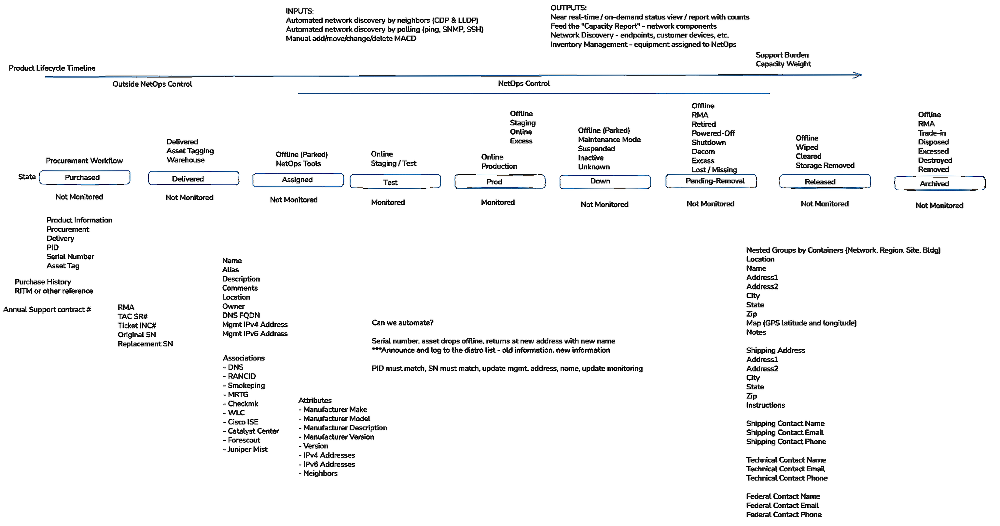

# hirdir

An inventory of the equipment, virtual machines, software and services a network
operations team answers for, from the purchase request to disposal: what there is,
where it is, who owns it, what it costs to keep supported, how much work it is, and when
it must be replaced.

**Status:** release 0.9.18, reference files. Photographs, maps, sketches and floor plans
are kept with the region, site or location they show, the documents of a vendor with the
models they are for, a carrier's letter of authorization with its circuit, and a
photograph of a device's labels with the device: each a file that `hirdir` keeps and
serves itself, for a closed network with no way out, or a link to one kept elsewhere,
with a title and a kind. A guide is uploaded once and put on every model it covers, and a
new edition replaces it on all of them; a room lists its own files and then those of the
floor, the building, the site and the region it is in, and a device those of its model
and of where it is. Files are of kinds an Admin chooses, up to 100 MB; a picture is shown
in the page and every other file is downloaded, so that nothing of one runs as part of
the application; removing one erases it at once; and the files are in the backup and come
back with a restore, on the same host or a clean one.
0.9.1 adds one command, `hirdir admin load-examples`, that loads the examples into an
empty inventory for a reset to take again, and a restore keeps set aside only what
undoing it takes. 0.9.2 opens every page with the menu bar in view, lets a site give the
product its own name, in the page and in the files it downloads, and says whom to ask:
the team that runs the installation, on About and, where an Admin chooses, on the
sign-in page. 0.9.3 makes every person a contact, of which a user and an operator are
each a part, so a person is entered once with an email and two numbers, and an operator
is internal where its person is a user and external where not; lets an Admin change a
username; makes the kinds of external system a list a site changes; and opens the form
of a setting, a tag, a lifecycle rule or a file beneath its row. 0.9.4 shows why each value is
what it is, from which group or place it comes, with a minor item's own groups first;
draws what each operator is on; and ranks the operators, the groups, the models and the
sites on every report. 0.9.5 is two reviews of the web UI for the work of each day: a box
to find an item on every page and one to find a place, plain words in the filter of every
list, another item like the last from the form of a new one, the buttons and the answer of
a long page kept in reach, and counts that come sooner and open what they count.
0.9.6 is a third review: a switch that joins and leaves a stack in one step and a stack
found by its name, a catalog entry chosen by searching, a list that keeps its place, a
contact's page that lists where the contact is named, counts of the reports that open
their rows, and an improvement to each page of purchases, vendors and contracts.
0.9.7 is what the first days of use asked for: a page that cannot be drawn says so and
offers to load again, and one older than the server says that a new version is
installed; every value of a list that names a record opens it; rows are ticked, and the
rows ticked are retired at once; a past import lists the records it made, to be retired,
or deleted by an Admin where they were a mistake; a place is named by its codes; and the
coordinates of a place open a map.
0.9.8 is a stack worked from its rows and the things that run on another: a member of
a stack is replaced in one press, a switch that stands alone is made a stack from its
page, and a spare goes round its pool as often as it is needed; a virtual machine, a
virtual context and a container are items that name their host, an item or a stack or a
cluster, and are where their host is; and what a tool reports is found by the tool's own
identifier, and marked when the tool reports it no more.
0.9.9 mends one fault of the web page: a list whose columns hold the lists of choices
stays as it was when its person comes back to the tab.
0.9.10 is the server saying how it is doing: a mark of its health in the menu bar of
every page, its last ten minutes on About with the slowest requests and who met them,
and past a ceiling an answer at once to wait in place of a request that times out; and
the imports and bulk edits applied by a second process, a service of its own.
0.9.11 gives that second process the long reports as well: it works out the coverage
report, the renewal worklist, the renewal alert and the capacity balance ahead, at
night and again once the inventory has been quiet for half a minute after a change,
and keeps them in the database, where the server finds them.
0.9.12 mends one fault of the web page: the form of a tall row of a table opens with the
button that opened it beside it, and not out of sight above.
0.9.13 is for the daily work of an Admin and of an operator, with fewer clicks: a new
user is made with its contact and its operator in one step, the lists of users, contacts
and operators each say which of the others a person is, a colour is pressed in a grid
or moved to by a slider, and every table is exported from the page that loads it, an
empty one as the template of its import.
0.9.14 is the round of the person: whoever signs in changes their own name, email,
numbers, organization, operator label and colour, and access code on a profile page;
a user account is retired, which is other than disabled; and the account, the contact
and the operators of one person are retired together, in one confirmation. 0.9.15
follows it: an account that holds no role does not sign in and is given a role when it
is made or brought back, a new access code is not the one it replaces and a Generate
button makes one, every list reached from the menu bar opens at its top, and an
address may be an interface's. 0.9.16 puts a user made by `hirdir admin create-user`
in groups, with a group's role. 0.9.17 adds agents, accounts that decide what to change,
answerable to a person, held to that person's role and never Admin, and marked in the
audit trail; says on a user's page where each role comes from; and makes Export
everything load whole into an empty inventory. 0.9.18 gives each side of a circuit its
dates and a circuit's Z side the carrier network it reaches; keeps the country and the
state of every address as codes chosen from lists an Admin keeps, starting with the
Americas; and puts telephone numbers, email addresses and people's names into one form
as they are typed or pasted.
This stands on 0.8.0, circuits. The telecommunication circuits the team looks after
are kept beside the inventory and share what it holds: their two ends are locations with
their site contacts, their carriers are vendors whose account team and support desk are
named once, their devices are items and groups, and their owner is an owner. Each has a
type, a speed of port, download and upload, and its monthly cost as the lines the carrier
bills; what circuits cost is reported by fiscal year, by carrier, site, region and group,
a part month as the carrier bills it, and circuits are put in groups whose cost is one
sum. A place may weigh by itself in the capacity balance, a default and a minimum
support weight give a quick estimate, Try answers what other figures would give without
saving anything, and the long reports are worked out each night and checked by an Admin.
This stands on 0.7.0, renewals in practice, and links. A worklist and an alert
after sign-in say what has to be acted on to keep the cover going; an agreement is
renewed with its member contracts, each confirmed by the operator, and those still
pending or expired are listed to review; a model or a device is flagged as not to be
renewed; the contacts of agreements and contracts are contact records; imports are
applied in the background, in batches, beside other work; purchase lines keep the part
numbers procurement gave them; values a site may change are settings; the capacity
balance is kept week by week, with lines that multiply staff capacity and the demand
of each region; and regions, sites, locations and models take links. This stands on
0.6.0 and 0.6.1, money, time and capacity. A support agreement with a
vendor groups contracts, and a contract covers one item or many: what an agreement or
a contract says is said once, and everything beneath has it or overrides it. A
contract is renewed in one place, with its new number and its new period, and every
item under it follows with nothing written to any of them: a renewal entered early
waits as the next term, and one that is late is marked as pending while the vendor
still gives support. The coverage report lists what is in service under no contract,
what is out of service and still counted by one, what runs out soon and what more
than one contract covers; the end-of-life report what is past and near each date, by
fiscal year;
and a vendor has its portfolio. A purchase request has lines that are received into
items. Items and device groups are registered with external systems. Capacity lines
are balanced against the support weight of the inventory, with and without the
drafts. This stands on 0.5.0, places and people: regions, sites and locations, an
item's location with its site and region, contacts and shipping details that a place
has from the nearest place above it, operators, and owners with their people; on 0.4.0
to 0.4.2, structure: minor items, stacks, clusters and controller domains, addresses,
the condition of an item with what was last observed of it, and the health that
follows; on 0.3.0, files and the command line; on 0.2.0, the inventory itself, with
vendors, a catalog of models, owners and items that inherit from their model and move
through the lifecycle; and on the skeleton of 0.1.0: the package installs and runs
behind nginx, people sign in, and an Admin manages accounts. A set of fictional
[examples](examples/README.md) loads into an empty installation. A host with an
earlier release is upgraded by installing the new package. What is left before 1.0.0
is timing at scale, backup and restore, the upgrade from every release, and an
accessibility pass. The order of work is in the
[build plan](docs/build-plan.md).

## What it does

- Tracks every item through nine lifecycle states, with what it is for (production,
  spare, staging, excess) and whether it is meant to be online.
- Sets a fact once and lets it fan out. End-of-life dates, estimated value, support
  weight and support cost live on the model and are inherited by every item of that
  model. Contacts and shipping details live on a region or site and are inherited by
  every location beneath. Any of them can be overridden where one item or place differs.
- Understands that four switches in a stack are four things to buy support for, one
  thing on the network, and somewhere between the two to look after.
- Sets the support weight of the infrastructure against the resource units that staff
  positions, outside services, tools and AI provide, for capacity planning.
- Gives technical staff a sortable, filterable grid in the browser, with import and
  export in CSV and JSON.
- Offers the same operations through a versioned API and a command-line client, so
  other tools can feed it and read from it.

## Documentation

| Page | Content |
|---|---|
| [Install and operate](docs/install.md) | Installing the package, nginx, accounts, backup, upgrade |
| [Requirements](docs/requirements.md) | What the product must do, and what it leaves alone |
| [Data model](docs/data-model.md) | The records, inheritance, identity, lifecycle, counting and weight |
| [Architecture](docs/architecture.md) | The software, access, the package and how it is tested |
| [Interfaces](docs/interfaces.md) | The API, the filter grammar, import and export, the CLI, the web UI |
| [Examples](examples/README.md) | A small fictional inventory as CSV and JSON, and how to load it |
| [Build plan](docs/build-plan.md) | Releases, parallel lanes and the acceptance scenarios |
| [Release process](docs/release-process.md) | Versions, release notes, the dependency rule, publishing these pages |
| [Decisions](docs/decisions.md) | What is decided, what is proposed, what is open |

## At a glance

| | |
|---|---|
| Runs on | Ubuntu 26.04 LTS, installed from one `.deb` under `/opt/hirdir` |
| Server | Python, FastAPI, SQLite |
| Web UI | TypeScript, AG Grid Community |
| In front | nginx from Ubuntu, terminating TLS, at any URL prefix |
| Access | Username and access code for now; three roles; no cookies |

Every example in this repository is fictional.

## Licence

[Apache License 2.0](LICENSE.md).
