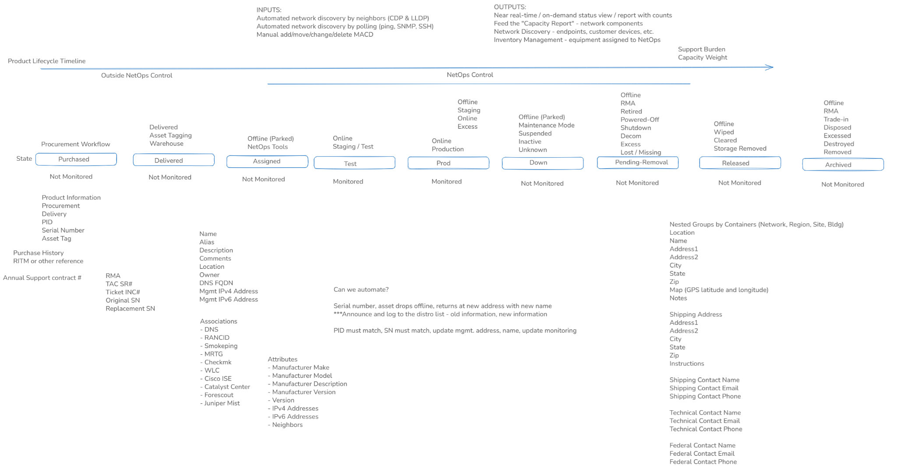

# hirdir

An inventory of the equipment, virtual machines, software and services a network
operations team answers for, from the purchase request to disposal: what there is,
where it is, who owns it, what it costs to keep supported, how much work it is, and when
it must be replaced.

**Status:** release 0.5.0, places and people. Regions hold sites, and a site holds
locations within one another: a building, a floor, a room, a rack. An item is given a
location, and its site and region follow; a power supply is where its switch is. Each
place has a path, `Americas > Central > Site-2 > Building 1 > Room 102`, and the tree
of places shows what is at or beneath each one. Contacts are assigned to a region, a
site or a location in a role, and a place with none of its own for a role has those of
the nearest place above it, as it has the shipping address and instructions: every
answer says which level a contact came from. A site is moved to another region by one
change, and the paths, the contacts and the totals follow with no item written to. An
owner has its people, a primary and alternates, and an item that is with an owner
outside the team says why. The management report is by site. This stands on 0.4.0 to
0.4.2, structure: minor items, stacks, clusters and controller domains, addresses, the
condition of an item with what was last observed of it, and the health that follows;
on 0.3.0, files and the command line; on 0.2.0, the inventory itself, with vendors, a
catalog of models, owners and items that inherit from their model and move through the
lifecycle; and on the skeleton of 0.1.0: the package installs and runs behind nginx,
people sign in, and an Admin manages accounts. A set of fictional
[examples](examples/README.md) loads into an empty installation. A host with an
earlier release is upgraded by installing the new package. Contracts, purchases and
capacity arrive with 0.6.0. The order of work is in the
[build plan](docs/build-plan.md).

## What it does

- Tracks every item through nine lifecycle states, with what it is for (production,
  spare, staging, excess) and whether it is meant to be online.
- Sets a fact once and lets it fan out. End-of-life dates, estimated value, support
  weight and support cost live on the model and are inherited by every item of that
  model. Contacts and shipping details live on a region or site and are inherited by
  every location beneath. Any of them can be overridden where one item or place differs.
- Understands that four switches in a stack are four things to buy support for, one
  thing on the network, and somewhere between the two to look after.
- Sets the support weight of the infrastructure against the resource units that staff
  positions, outside services, tools and AI provide, for capacity planning.
- Gives technical staff a sortable, filterable grid in the browser, with import and
  export in CSV and JSON.
- Offers the same operations through a versioned API and a command-line client, so
  other tools can feed it and read from it.

## Documentation

| Page | Content |
|---|---|
| [Install and operate](docs/install.md) | Installing the package, nginx, accounts, backup, upgrade |
| [Requirements](docs/requirements.md) | What the product must do, and what it leaves alone |
| [Data model](docs/data-model.md) | The records, inheritance, identity, lifecycle, counting and weight |
| [Architecture](docs/architecture.md) | The software, access, the package and how it is tested |
| [Interfaces](docs/interfaces.md) | The API, the filter grammar, import and export, the CLI, the web UI |
| [Examples](examples/README.md) | A small fictional inventory as CSV and JSON, and how to load it |
| [Build plan](docs/build-plan.md) | Releases, parallel lanes and the acceptance scenarios |
| [Release process](docs/release-process.md) | Versions, release notes, the dependency rule, publishing these pages |
| [Decisions](docs/decisions.md) | What is decided, what is proposed, what is open |

## At a glance

| | |
|---|---|
| Runs on | Ubuntu 26.04 LTS, installed from one `.deb` under `/opt/hirdir` |
| Server | Python, FastAPI, SQLite |
| Web UI | TypeScript, AG Grid Community |
| In front | nginx from Ubuntu, terminating TLS, at any URL prefix |
| Access | Username and access code for now; three roles; no cookies |

Every example in this repository is fictional.

## Licence

[Apache License 2.0](LICENSE.md).
