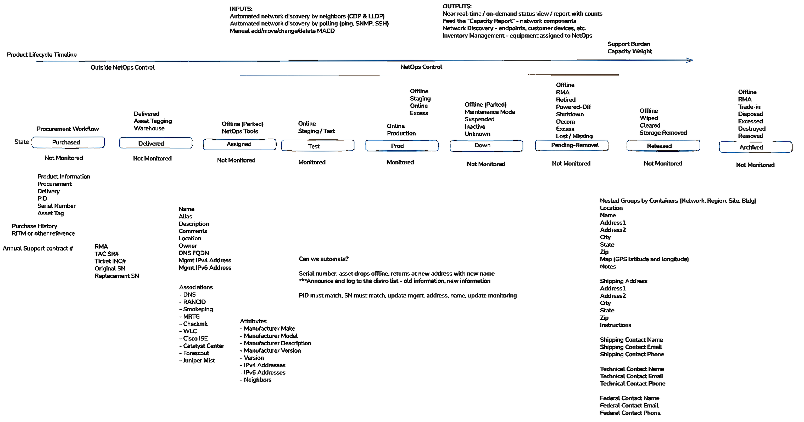

# Data model



The records `hirdir` keeps and the rules between them. Field names here are the names
used in the database, the API, JSON and CSV. A change to a name on this page is a change
to every interface, so it is made here first.

## Conventions

| Subject | Rule |
|---|---|
| Identity | Every table has `hid`, a UUID version 7 in lower-case canonical text, assigned by the server. It is the primary key and the only thing other records reference. |
| Bookkeeping | Every editable table has `created_at`, `updated_at` (UTC), `created_by`, `updated_by` (user HID) and `row_version` (integer, starts at 1, plus one per change). |
| Stale edits | An update names the `row_version` it was made against. A mismatch is refused with `409`. The database makes the same check as it writes, so of two changes made against one version at the same moment only the first is applied. |
| Removal | An item and a device group are retired, and are deleted only by an Admin, as a mistake that nothing else depends on: what belongs to the record alone goes with it, a record that another depends on is refused with what refers to it, and the audit event of the deletion holds the record as it was, what went with it and the reason, beside the events it had before, which stay (P-227, P-236). Regions, sites, locations, contacts, operators, owners, agreements, contracts, external systems, capacity lines, catalog entries, circuits and circuit groups are never deleted. All of these carry `record_status`. A membership of a group and a coverage under a contract are ended with a date. A registration is given the status `removed`, and a purchase request the status `cancelled`. An address, a contact assignment, a member of an owner, a contact of a contract, a coverage, a registration or a record of the capacity balance that was a mistake, a contact of a vendor or of a circuit, a carrier, a cost line or a device of a circuit, and a member of a circuit group, an attachment of a reference, and a network or a tag that nothing uses, is removed outright, and the audit event of the removal holds what it was. A reference is erased, with its content, when it is taken off the last record it is on or erased from all of them at once (P-160). |
| `record_status` | `draft`, `active` or `retired`. Draft and retired records are left out of counts and default views. |
| Dates and times | Dates are `YYYY-MM-DD`. Timestamps are stored, and travel through the API and files, as ISO 8601 in UTC. One that comes in naming no zone, in a request, a file or a filter, is in the application's time zone. A person is shown the application's time with the name of the zone, `2026-01-31 14:05:09 EST`: the `time_zone` setting, the same for everybody whatever zone they are in. |
| Money | Decimal with two places, one currency for the installation, named in settings. |
| Decimals | Two places: money, support weight and percentages alike. In JSON a decimal is written as text, `"18000.00"`, so that nothing is lost on the way to a browser. A number is accepted on the way in. |
| Blank | A blank text field is stored as nothing at all, and is `null` in JSON. |
| Text keys | Compared without regard to case or surrounding space. The text as entered is what is stored and shown. |
| History | The past value of any field is answered from `audit_events`. Only group membership and contract coverage keep their own date ranges, because reports ask about them directly. |
| Portability | Column types and constraints are limited to what SQLite and PostgreSQL both support. |

## Inheritance

One rule, used everywhere: **a blank inherits, a value overrides, and the answer says
where it came from.**

| Field on | Inherits from, nearest first |
|---|---|
| Item: `est_value`, `support_weight`, `annual_support_cost`, `end_of_sale`, `end_of_sw_support`, `end_of_hw_support`, `ldos`, `do_not_renew` | its catalog entry; for the `support_weight` of a major item, then the setting `default_item_weight` |
| Site: `support_weight` | the setting `default_site_weight`. A region and a location have their own alone, and no place passes its weight down |
| Circuit: `support_weight` | the setting `default_circuit_weight` |
| Circuit: `down_mbps`, `up_mbps`, each by itself | its own `port_mbps`, the full rate of its port |
| Circuit: the contacts of each role, `account_manager` and `support_contact`, all of one role together | its primary carrier, the vendor |
| Circuit: the site contacts of each side, per role | the location of that side, resolved as for the location |
| Catalog entry: `stack_discount_pct` | the global setting |
| Item: `location_hid`, `planned_location_hid`, `owner_hid`, `operator_hid` | its own groups; for a minor item, then the item it is in and that item's groups, up to the top; for an item that runs on a host, then its host and the groups of that, up in the same way (P-246); a group answers with its own or that of the group it is nested in. See "Groups, and which of them decides" below |
| Item of the kind `virtual_context`: `serial_number`, where it has none | the item it runs on. See "What runs on a host" |
| Item: `operator_hid`, where none of those has one | the location it is at, the locations above that, the site, and each region outward |
| Minor item: `lifecycle_state`, `disposition`, `expected_online`, taken together | the nearest item above it that has a lifecycle state |
| Contract: `reseller_hid`, `starts_on`, `ends_on`, `support_level`, `account_manager`, `support_contact`, `support_url`, each by itself | the support agreement it is grouped into |
| Contract: the contacts of each role, `account_manager` and `support_contact`, all of one role together | the support agreement it is grouped into |
| Location: contacts per role, shipping address, shipping instructions | its parent location, its site, then each region outward |
| Site: the same three | each region outward |

The API returns an inheritable field as its own stored value plus an `effective` block:

```json
{
  "est_value": null,
  "effective": {
    "est_value": { "value": "18000.00", "source": "catalog", "source_hid": "0193a1f4-6c2e-7b41-9d0a-5e3f8c1a7b22" }
  }
}
```

`source` is one of `own`, `catalog`, `parent_item`, `host`, `device_group`, `location`, `site`,
`region`, `agreement`, `vendor`, `port`, `setting` or `none`. `location` is a location above the one asked about. Grids and exports show the effective value and offer a
`<field>_source` column. Writing a value sets the item's own. Writing `null` returns it
to inheriting.

In `effective` a decimal and a date are text, a reference is the HID of the record, and
`expected_online` is `true` or `false`. `source_hid` is the record the value came from:
for `parent_item`, the item above that holds it, which need not be the direct parent.
For `device_group` it is the group that holds it, which may be one that the item's
group is nested in. A location in force, `effective.location_hid` and
`effective.planned_location_hid`, also has `source_label`, the name of that item or
group, so that a page says "from site2-sw-stack1" without another request.

### Groups, and which of them decides

A record has one parent of each kind, but for one: an item may be in several device
groups at once. So the rules below say which of them an item has a value from. They are
the rules of D-128, D-129, D-134 and P-175, said in one place, for whoever runs
`hirdir` or builds on it.

**What may be in more than one group**

| Record | In more than one? | What it has from them |
|---|---|---|
| An item, in device groups | yes: at most one stack and one cluster at a time, and any number of controller domains and custom groups | its location, its planned location, its operator and its owner, where it has none of its own |
| A device group, nested | no: one group it is in | the same four, from that group and the groups above it |
| A location, a site, a region | no: one parent location, one site, one region | contacts by role, the shipping address and instructions, the operator, each up that one line |
| A contract | no: one support agreement | the dates, the support and the contacts that it does not override |
| A circuit, in circuit groups | yes, any number | nothing: a circuit group is a way of looking at circuits and costing them |
| A user, in user groups | yes | its role, the highest of what it and every group of its is granted, so no two can tie |
| A contact | named by any number of places, owners, operators and users | nothing: what is true of a person is kept on the contact, and the others read it |

**How an item finds a value it does not have.** It walks up from itself, one record at
a time, and takes the first value it finds:

1. its own value;
2. its own groups, the current memberships in groups that are not retired, ranked as
   below;
3. for a minor item, the item it is in, and then that item's own groups; then the item
   that one is in, and its groups, and so on to the top (P-175);
4. for an item that runs on a host, what it runs on: the host item, and then that
   item's own groups, and on from it as from any item, the item it is in or what it
   runs on in its turn; or the stack or the cluster it runs on, which answers as a
   group does (P-246). A minor item of a virtual machine comes to the machine by step
   3 and to the machine's host by this one;
5. for the operator alone, where nothing above has one: the location the item is at in
   force, the locations above it, its site, and each region outward.

A group answers with its own value, or else the value of the group it is nested in, or
of the one above that, at most eight deep. So a stack with no operator of its own, nested
in a controller domain that has one, answers with the domain's.

**How an item's groups are ranked.** A stack comes before a cluster, a cluster before a
controller domain, and a controller domain before a custom group. The first of them
that answers with a value decides, whether the value is its own or from a group it is
nested in. A stack cannot tie with another stack, nor a cluster with a cluster, as an
item is in one of each at most. Two groups of one type are taken by name, without regard
to case, and two of one name by their HID, which is never reused.

**When two groups both have a value**, the one that ranks first decides and the other
is passed over. An access point in the controller domain `east-wlc`, whose operator is
`LM`, and in the custom group `lobby-aps`, whose operator is `Op2`, has `LM`: a domain
ranks before a custom group. In two custom groups `Alpha`, `Op2`, and `beta`, `Op3`, it
has `Op2`, as `Alpha` comes first by name. An optic in switch `sw-01`, whose own operator
is `LM`, that is also in the custom group `Optics pool`, operator `Op2`, has `Op2`: its
own group is nearer to it than the item it is in. A value of the item's own always
decides: the access points of a domain are each where they hang.

**What the answer says.** Every value in force comes with its source, `own`,
`parent_item`, `host` where an item it runs on, or an item that one is installed
in or runs on, holds it, or `device_group` where a group holds it, the stack or the
cluster it runs on among them, so that `host` always names an item and
`device_group` a group,
then `location`, `site` or `region` for the operator,
and with the HID of the record that holds it, which for a group may be the one that the
item's group is nested in. Nothing is copied down: putting an operator on the group
changes what every member that has none shows, and writes to none of them. Being passed
over is no fault, and is not reported, but for the owner: a group lists in
`members_disagree` each current member whose owner in force is another. An operator that
is retired is passed over at every level as if it were not there, and a group that is
retired, or a membership that has ended, counts for nothing: a retired group passes
nothing down to the groups nested in it (P-181). The whole walk, with what
each step holds and which decided, is answered by `GET /items/{hid}/resolution` and
shown on the page of an item (P-176).

## Records

### `vendors`

A manufacturer, a support provider, or both. A name or alias belongs to one vendor only.

| Field | Type | Notes |
|---|---|---|
| `name` | text, unique | "Cisco", "Juniper", "Canonical" |
| `aliases` | list of text | Other spellings accepted on import: "Cisco Systems". An alias holds no semicolon, which separates aliases in a file |
| `notes` | text | |
| `review_status` | choice | `reviewed`, or `unreviewed` when an import created it |

A vendor that is a carrier names its account team and its support desk once, in
`vendor_contacts`, and its circuits have them (see `circuits`).

### `catalog_entries`

What is true of every item of one model. Unique on (`vendor_hid`, `pid`).

| Field | Type | Notes |
|---|---|---|
| `vendor_hid` | reference | required |
| `pid` | text | required. The product ID as the vendor writes it: `C9300-48P` |
| `model_name` | text | "Catalyst 9300 48-port PoE+" |
| `kind` | choice | `hardware`, `virtual_machine`, `virtual_context`, `container`, `software`, `service`. Left out, `hardware`. A virtual context is a virtual device context of a switch, or the like of it in a firewall. The three in the middle run on a host: see "What runs on a host" under `items`. Not changed to a kind that has no host while an item of the model names one |
| `type` | choice | switch, router, firewall, wireless-controller, access-point, phone, server, test-equipment, power-supply, module, application, and so on |
| `function` | choice | access, aggregation, core, edge, management, and so on |
| `description` | text | "access, 48-port" |
| `end_of_sale`, `end_of_sw_support`, `end_of_hw_support`, `ldos` | date | |
| `est_value` | money | planning estimate per unit |
| `support_weight` | decimal | relative effort to support one unit; no unit of measure |
| `annual_support_cost` | money | per unit per year; expected to be blank at first |
| `stack_discount_pct` | 0 to 100 | blank inherits the global setting |
| `successor_hid` | reference | the model that replaces this one, for refresh planning |
| `do_not_renew` | boolean | its support is not to be renewed: gear whose cover came with its purchase and is not bought again. False unless said. See "Not to be renewed" |
| `links` | list | addresses to reach about the model, each with its text: see "Links" |
| `review_status` | choice | `reviewed`, or `unreviewed` when an import created it |
| `record_status` | choice | see Conventions |

### `items`

One tracked thing. At least one of `serial_number` with `catalog_entry_hid`,
`asset_tag`, `name` or `hostname` is required. Everything else may be blank, the three
lifecycle fields included.

| Field | Type | Notes |
|---|---|---|
| `catalog_entry_hid` | reference | optional, because some things arrive with only a name |
| `serial_number` | text | unique with the catalog entry when present |
| `mac_address` | text | stored as twelve lower-case hex digits; not unique |
| `asset_tag` | text | unique when present |
| `name` | text | the name the team uses. Blank shows `hostname` |
| `hostname`, `fqdn` | text | for a stack member these are usually blank; the stack holds them |
| `description`, `comments` | text | |
| `parent_item_hid` | reference | set on a minor item: the item it is installed in or attached to |
| `position` | text | where in the parent: "PS-A", "Slot 3", "Bay 7". Only a minor item has one |
| `host_item_hid`, `host_group_hid` | reference | what the item runs on, as a person names it: an item, or a stack or a cluster. One or neither. Only an item of a kind that runs on a host has one. See "What runs on a host" |
| `observed_host_hid`, `host_observed_at` | reference, timestamp | the item it was seen to run on, and when: an observation, set together |
| `quantity` | integer, default 1 | seats or licences for software and services |
| `lifecycle_state` | choice | see below |
| `disposition` | choice | see below |
| `expected_online` | boolean | intent, not observation |
| `state_reason` | choice | "RMA", "maintenance", "lost", and so on |
| `state_changed_at` | timestamp | |
| `condition` | choice | the state of the hardware as a person knows it; see "Condition, observation and health" |
| `observed_status` | choice | `online`, `degraded`, `unreachable` or `present`: what is seen of it. Blank until somebody says |
| `observed_at` | timestamp | when that was seen. Set with `observed_status`, to now unless another moment is given |
| `owner_hid`, `location_hid` | reference | |
| `planned_location_hid` | reference | where the item is going: a location that is not in use yet. See "A planned location" |
| `operator_hid` | reference | an operator: the label of the person of the team who looks after the item. Blank inherits; see "The operator" |
| `purchase_line_hid` | reference | the request line it arrived on |
| `procured_on`, `delivered_on`, `in_service_on` | date | |
| `warranty_start`, `warranty_end` | date | |
| `est_value`, `support_weight`, `annual_support_cost` | override | blank inherits |
| `end_of_sale`, `end_of_sw_support`, `end_of_hw_support`, `ldos` | override | blank inherits |
| `do_not_renew` | override | true or false; blank inherits the model's. See "Not to be renewed" |
| `record_status` | choice | see Conventions |

A **major item** is one with `parent_item_hid` blank. `is_major` is derived and is
available as a filter and a column. So is `depth`: 0 for a major item, 1 for a minor
item of it, and so on.

**Minor items.** A minor item has exactly one parent, and may have minor items of its
own: a module in a blade in a chassis. Minor items nest at most three deep beneath a
major item, and an item is never above itself. A minor item may have its own serial
number, catalog entry, name and addresses. A current member of a stack or a cluster is
a major item, so it is not given a parent, and a minor item is not made a member of
one.

A minor item whose own `owner_hid` is blank, and whose own groups have none, has the
owner of the nearest item above it that has one, and one whose own `location_hid` is
blank is where the nearest item above it is that has a location: a power supply is in Room 102 because its switch is. Its standing is taken as a whole: with a `lifecycle_state` of its own it
has its own disposition and intent, and with none it has all three of the nearest item
above it that has a state. A power supply is in production because its switch is, and
the one that failed is moved to Pending-Removal by itself. It is returned to inheriting
by a transition to no state. Nothing is copied down: moving the switch changes what
its minor items show, and writes to none of them.

**From its group.** What is set once on the record above is had by the records
beneath it that say nothing of their own, down every hierarchy, with an override at
every level. So an item with no location of its own is where a device group is that it
is a current member of, and one with no planned location is planned for where its group
is planned for, as it has its group's operator. A minor item's own groups come before
the item it is in (P-175). An operator puts devices into a group and moves the group, and does not go
back to each device. Where an item is in several groups, the first that has a value
decides: a stack before a cluster before a controller domain before any other group,
and then by name; "Groups, and which of them decides" under Inheritance says it whole.
A group that has none has that of the nearest group it is nested in. A member with a location of its own keeps it, as an override: the access points
of a controller domain are each where they hang. Every answer says where the value
came from, `own`, `parent_item` or `device_group`, and from which record. The owner
is had in the same way: an item with no owner of its own has the owner of its group, or
of the item it is in, and is an exception when that owner is outside the
team. A group still lists in `members_disagree` a member whose owner in force is
another: its own, from the item it is in, or from a group that ranks first.

**What runs on a host** (P-226, P-246). A virtual machine on a hypervisor, a virtual
context in a switch and a long-lived container are items of their own, each seen on
the network by its name and its address, and each runs on something: an item, or a
stack or a cluster where the hosts are one. It is the reverse of a member of a stack,
which takes the stack's name and address and keeps its own place in the records: what
runs on a host keeps its name, its addresses and its state, and has its place from
its host.

- **Which items.** An item whose model is of the kind `virtual_machine`,
  `virtual_context` or `container`. An item of another kind, or with no model, is
  given no host. Such an item may be entered with no host, and is then marked for
  review, `no_host`: see "What is to be looked at".
- **The host is two facts**, as the master of a stack is. `host_item_hid` or
  `host_group_hid` is the host that is *intended*, which a person names: the server
  the machine was built on, the cluster it belongs to, the switch a context is
  configured in. `observed_host_hid` is the host it was *seen* on, with
  `host_observed_at`: a machine moves between the hosts of a cluster with or without
  anybody's doing, so this is an observation, set by hand or by an import and LATER
  by a tool. Clearing it clears its moment; a moment more than a day ahead is
  refused. No rule depends on it. `host_differs` on the record is true where both are
  known and the item seen is neither the host named nor a current member of the stack
  or cluster named, which is no fault.
- **What may be a host.** An item of the kind `hardware` or `virtual_machine`, or with
  no model, that is not retired and has not left the team's hands when it is named; a
  minor item as well, since a blade in a chassis is one. Never the item itself, nor
  one that runs on it, and the line of hosts is at most three long: a container in a
  virtual machine on a server. A group that hosts is a `stack` or a `cluster`, the two
  that are one device, and is not retired. The item seen is any item that is not the
  item itself.
- **A major item.** What runs on a host is installed in nothing: it has no
  `parent_item_hid`, and an item with a parent is given no host. It may have minor
  items of its own, and be a member of groups, as any major item.
- **What it has from its host**: its location, its planned location, its owner and
  its operator, where it has none of its own and its own groups have none, resolved
  when it is read and never copied down, with the source `host` and the item that
  holds the value, or `device_group` and the group where a group holds it: one a host
  is a member of, the stack or the cluster it runs on, or a group that one is nested
  in. Moving the server moves what runs on it and writes to none of it.
  An override is the item's own value, as everywhere. Nothing of its standing comes
  from its host: its lifecycle state, disposition and intent are its own, and a blank
  state is blank.
- **A virtual context shows its host's serial number, and the serial number given
  for it names its host** (P-251). It has none of its own: what a tool reads from it
  is the chassis's. A `serial_number` given for an item of the kind `virtual_context`,
  through the API, a file or a bulk edit, is looked up among the items that may be a
  host, not retired, whose own serial number it is, compared as the unique rule
  compares it. Where one item has it, that item is the context's host from that
  change, held to every rule of naming a host, and the serial number is not stored; a
  request that names another host as well is refused on `serial_number`, naming both,
  and so is a serial number that more than one such item has, naming them, never a
  guess. Where no item has it, the context keeps it as given, its own column, until
  its host is known, and is marked `no_host`; once one item that may host has that
  serial number, the reason names it in its `about`, for a person to make it the host.
  Nothing joins the two by itself when the switch is entered: the next report that
  names the context, or a person, does. A context that is given a host, by whatever
  way, holds no serial number from then on: what it held is cleared in the same
  change, audited with it, and it shows its host's, so that a context moved to another
  switch shows that switch's. `effective.serial_number` is its host's, with the source
  `host`; the list and the page show it as from its host. It is not unique to the
  context and not what a row of a file is matched by (see "Identity and matching"),
  and a filter or a sort of the item list by `serial_number` sees only an item's own:
  the context is found by its host, `host.name`. A virtual machine and a container
  keep a serial number of their own, where they have one, and show none but that.
- **Counting.** Each is a major item of a kind in `count_kinds` from the start: a
  component, a managed node of its own, and its support weight, by the rules of
  "Counting and weight". It is counted where it is, which is where its host is.
- **What runs on a record** is listed by `GET /items/{hid}/hosted` and `GET
  /device-groups/{hid}/hosted`: each item that names it, and beneath each what runs
  on that, with `depth`; retired ones only where asked. The record of an item and of a
  group says how many run on it, `hosted_count`, of those not retired.

**What follows from a host** (P-247).

- **Retiring an item retires what runs on it**, and what runs on that, in the same
  change: each has its own `retire` event, which names in `retired_with` the host it
  went with, and each ends its memberships and its coverage as any item retired does.
  A virtual context cannot be without its switch. This is unlike a stack on purpose,
  whose retirement ends its memberships and leaves its switches as they are.
  `POST /items/retire` with `dry_run` changes nothing and answers the same, with
  `hosted`, the items that go with those named: it is what the web shows before it
  asks. Bringing the host back brings back none of them.
- **Retiring a stack or a cluster that something runs on is refused**, naming what
  runs on it: each is given another host, or retired, first. Retiring one host of a
  cluster leaves what runs on the cluster with the cluster.
- **Deleting** (P-227) is refused for an item or a group that an item names as its
  host, retired or not, with the items that name it. What was seen to run on a
  deleted item is cleared of it, with an event that says so.
- **A replacement hands over what runs on the item that left** to the item that came,
  each with an event of its own that names the replacement, as it hands over the
  memberships and the circuits, unless the request gives `hand_over_hosted` false.
  The item that comes must be one that may be a host, where anything is handed over.
  The host that was seen is not handed over.
- Nothing else follows by a rule. A host that leaves the team's hands, by a move to
  Released or to Archived, changes nothing of what runs on it, which is then marked
  for review, `host_gone`; so is an item brought back while its host is retired.

**What is to be looked at** (P-249). `review` on an item's record lists the reasons a
person should look at it, each with what it is about, and is empty where there is
none:

| Reason | When | Put right by |
|---|---|---|
| `no_host` | the item is of a kind that runs on a host, and names none | naming its host |
| `host_gone` | the host it names is retired, or is an item that has left the team's hands | naming another host, or retiring the item |
| `not_reported` | an external system it is registered with reports it no more: a registration of the item has that status (see `external_systems`) | finding out what became of it: it is retired by a person, or the next report names it again |

A reason is a mark. It refuses no change and moves nothing, and is worked out when the
record is read. A retired item has none. `review` filters and shows on the item list:
`review:eq:no_host`, and `review:empty:false` for every item with a reason.

Taking a minor item out of its parent, by clearing `parent_item_hid` or naming another
parent, keeps its record and its history. With no parent it is a major item, with
whatever is its own: what it inherited stays with the parent it left.

`purchase_line_hid` arrives in release 0.6.0, with the purchase requests. An item that
is received on a line is created with it; it may also be set by hand, on an item that
was entered before its request was. An item on a line is of the line's model: one that
is put on a line and names no model takes the line's, one that names another is
refused, and the model of an item is not changed while it is on a line. What 0.6.0 let
in is left as it is, also by an edit of anything else, and `purchase_line_mismatch`,
true on the record and in the item list where an item is on a line of another model,
finds it to be put right.

**Coverage and registrations.** An item's record lists the coverages it has under
contracts, with `covered`, true when one of them is in force today, and
`covered_until`, the last day its cover runs to. It lists the external systems it is
registered with. See `contracts` and `external_systems` below.

**A planned location.** `location_hid` is where an item is. `planned_location_hid` is
where it is going, when that place is not in use yet. A team that plans a new site
makes the site as a draft, with its buildings and rooms, and gives the spares that are
meant for it their planned locations there. Until the site opens the spares are where
they are, in staging, counted there and found there, and the draft site shows what is
planned for it. When the site is made active, every item that is planned for a
location thereby in use is moved in by the same change: its location becomes the
planned one and the plan is cleared. Each item has an entry of its own for it in its
history, with the request ID of the change that opened the site, and nobody moves
anything device by device.

Making a place active is so a change that reaches into the inventory, and nobody
makes it without being shown what it brings about. `GET /sites/{hid}/opening`, and
the same for a region and a location, says how many items and device groups would
move in and how many records would be written to, and changes nothing. The web UI
makes a place active only through a question that shows those numbers, and the
preview of a file that makes a place active has them in the notes of its row.

A place is in use when it and everything it is in is active: the locations above it,
its site and the regions above that. Only a location that is not in use is taken as a
plan. One that is in use is refused, since the item can be moved there now, and so is
one that is retired. A plan is given up by clearing it, and is cleared when the item
is given the planned location as its location. Giving the item another location in
the meantime, another shelf in staging, leaves the plan standing. A retired item is
not moved. A location is not retired while items or groups are planned for it.

A device group has a planned location in the same way, and is moved in by the same
change, with its own entry in the audit trail. What says nothing of its own goes with
what it is in: a minor item with its item, a member with its group, a group with the
group it is nested in, what runs on a host with its host (P-246). Such a record with no location of its own needs no change when
the place opens: it is where the record above it is. One that has a location of its
own, the store room it was put in, and its plan from above gives that location up in
the same change, with an entry of its own in its history, and is thereafter where the
record above it is. One with a plan of its own goes where that says. So a stack and
its switches are planned for a new site by one change of the stack, and are all there
when the site is made active.

**A draft place as a workspace.** A room that is rebuilt is replaced in the same way.
The new room is made as a draft beside the old one, under the name of the project. New
equipment is given it as its location; what is live in the old room is given it as
its planned location, by one bulk edit. Making the new room active is the cut-over:
everything planned for it is there. The old room, now empty, is retired. A retired
place keeps its name, and two places in one place may not have one name, so the old
room is renamed out of the way, which a retired place allows, and the new room is
then given the real name. A rename is one change of one record: the paths of what is
in the room follow, and no item is written to. The contacts, the shipping details
and the operator of the old room are its own and do not move with the equipment:
they are set on the new room while it is a draft. Where a room is only given another
name, it is renamed, and none of this is needed.

**The operator.** The owner of an item is the part of the organization that answers
for it. Its operator is one person: the member of the team who looks after it, and
who is asked about it. An item is not given the person but a label that stands for
the person, a record of `operators`, below. `operator_hid` names one, on an item, on
a device group, and on a region, a site and a location. For an item the operator in
force is resolved when it is read, the nearest first:

1. the item's own;
2. for a minor item, that of the nearest item above it that has one;
3. that of a group which the item at the top of that line is a current member of: a
   stack before a cluster, a cluster before a controller domain, a controller domain
   before any other group, and of two of one type the first by name; where that group
   has none, that of the nearest group it is nested in;
4. that of the location the item is at, then of the locations above it, of its site,
   and of each region outward.

An operator that is retired is passed over at every level, as if it were not there.

So a stack is given an operator once and its four switches have it, with their power
supplies; forty access points have the operator of their controller domain; a switch
that arrives at a site with nobody named for it has the operator of the site; and the
one switch that somebody else looks after is given its own. The answer says where it
came from: `own`, `parent_item`, `device_group`, `location`, `site` or `region`, with
the record that holds it. Nothing is copied down: giving the stack another operator
changes what its members show and writes to none of them. A device group shows its
operator in force in the same way, its own or that of a group it is nested in, and a
place its own or that of the place it is in.

An item with no operator in force is looked after by nobody in particular. It is
found with `effective.operator_hid:empty:true`, and counted in the blank row of a
report by `operator`.

### `item_replacements`

| Field | Type | Notes |
|---|---|---|
| `old_item_hid`, `new_item_hid` | reference | both records remain |
| `reason` | choice | a value of the `replacement_reason` list: `rma`, `refresh`, `project`, `upgrade`, `other` |
| `reference` | text | RMA, service request or ticket number |
| `replaced_on` | date | left out, today in the application's time zone |

A replacement is made by `POST /items/{hid}/replace` on the item that leaves. The item
that takes its place is one that exists, or is created by the same request. What is
handed over is the role, the mark of the intended master with it; the master that was
seen is not, because nobody has seen the new item as master. The new item takes over
the old one's current memberships of groups, with the same role and position: each of
the old ones ends on `replaced_on` and each of the new ones begins then, so a stack
keeps its HID and its master through an RMA. The old membership ends before the new
one begins, so the position it held is free for the new item (P-219).

**An item is replaced, and takes another's place, as often as that happens** (P-241).
A spare goes into a stack for a member that failed, is pulled a year later and goes
back to the pool, and takes the place of another; the switch that came back from the
manufacturer takes the place of the one that had taken its own. Two things are
refused: an item does not take its own place, and one item does not take the place of
the same other twice on one day, which is the uniqueness of the table: the two items
with the day. An item's record lists its `replacements`, each with the other item,
whether this one `left` or `came`, the reason, the reference and the day, the latest
first, by the day and then by when it was entered; `replaces` and `replaced_by` are
the latest of each, or null, on the record of an item and in `hirdir items show`; the
item list has no field of them and an export of items no column, since the
replacements travel as their own file.

**A replacement moves neither item by a rule, and changes of each what its request
names** (P-242). With `drop_identity`, where the item that leaves is a current member
of a stack, the item that comes gives up its own host name, FQDN, addresses and
location as a member that joins does (P-217), and may be given a disposition and an
intent. With `old_item` the item that left is given what becomes of it, as a member
that leaves is (P-218): a host name and an FQDN, a location, a lifecycle state with its
reason, a disposition, an intent and a condition (P-245). Each is checked by that
item's own rules once the places are handed over, and audited as its change, which
names the replacement it came from in `replacing`; where one is refused the
replacement is not made. What a replacement changes of either item, what becomes of
the old one and what the new one gives up and is given, is done with the request, so
it is given with a day that has come.

**A replacement that was a mistake is removed by an Admin** (P-238), with a reason:
`POST /item-replacements/{hid}/remove`. The audit event, `delete`, holds the
replacement as it was, and each of the two items has an event of it in its history.
What the replacement handed over, memberships and the connections of circuits, stays
as it is: each is a fact of its own, put right on the page of its group or its
circuit. Nothing else removes a replacement, and an item that is part of none may be
deleted by the rule of every other (P-227).

The record arrives in release 0.4.0. From 0.6.0 replacements travel in files, as
`item_replacements`, and `GET /reports/replacements` lists them with the count of each
reason. A row of a file is matched by its HID, or else by its two items and its day. A
row that gives no day is the one replacement of those two items where there is one,
and a new one, of today, where there is none; where there are several it is rejected,
and asks for the day.

### `device_groups` and `device_group_members`

| Field | Type | Notes |
|---|---|---|
| `type` | choice | `stack`, `cluster`, `controller_domain`, `custom`. Not changed once the group has had a member |
| `name` | text, unique | required |
| `hostname`, `fqdn` | text | for stacks and clusters |
| `parent_group_hid` | reference | nesting; cycles refused, and at most eight deep |
| `location_hid`, `owner_hid` | reference | optional. Where the group is, when it is in one place, and who answers for it. A member with none of its own has the group's (D-129), and one with its own keeps it |
| `planned_location_hid` | reference | optional. Where the group is going, in a place not in use yet, as on an item. Its members that have no plan of their own are going there too |
| `operator_hid` | reference | optional. An operator, for the group and for each member that has none of its own |
| `managed_as` | choice | a cluster only: `one`, `members` or `members_and_cluster`. Left out, `one`. See "Counting and weight" |
| `expected_members` | integer | optional: how many members the group is meant to have |
| `observed_master_hid` | reference | a stack only: the current member that is seen to be master now. Set with `observed_at` of its own, `master_observed_at` |
| `observed_status`, `observed_at` | choice, timestamp | what is seen of the group as one device, as on an item |
| `record_status` | choice | see Conventions |

| Member field | Type | Notes |
|---|---|---|
| `group_hid` | reference | |
| `item_hid` | reference | |
| `role` | choice | stack: `master`, `member`. cluster: `active`, `standby`, `member`. controller domain: `controller`, `endpoint`. custom: `member` |
| `position` | integer | stack member number. The members of a stack are numbered: one added with none takes the lowest free number from 1, and a number is held by one current member (P-219) |
| `joined_on`, `left_on` | date | `joined_on` left out is today. `left_on` blank means current |

Rules, checked on every write:

- The members of a `stack` are major items. A stack may be one switch alone: it waits
  for its second in staging, and is left with one in production when a member fails
  and is taken out. A stack with no members at all is accepted, as one whose members
  are still to come.
- **The master of a stack is two facts.** The role `master` marks the master that is
  *intended*: the member given the priority in its configuration. It is optional. A
  stack has at most one, and marking another member unmarks the one that had it, in
  the same change. `observed_master_hid` is the master that is *seen*: which member
  the stack made master when it last booted. That is decided by the stack and may move
  over time, so it is an observation, set by hand or by an import and LATER by a
  monitoring tool. No rule depends on either, and neither stops a member leaving. The
  record says when the two differ, which is not a fault.
- Members may be added several at a time, by one request.
- **A position in a stack is held by one current member** (P-219). A member is not
  added at, nor moved to, a position that another current member holds, and two
  members added together are not given one position. A membership that has ended
  keeps its number and holds nothing, so that the switch that takes the place of one
  that left takes its number. A member added with no position takes the lowest from 1
  that is free. Two members that hold one position from before this rule stay as they
  are until one of them is moved, and do not stop any other change of the stack. A
  replacement hands its position to the new item as it is.
- **A switch that joins a stack may take the stack's name and place** (P-217). Added
  with `drop_identity`, in the same change, the item's own host name and FQDN are
  cleared, its addresses are removed, and its own location is cleared, so that the
  stack's is in force. Nothing of the stack is copied to it: the stack's host name,
  FQDN, addresses and location stay the stack's, and are read from it. A member of a
  cluster or of a controller domain keeps its name. The disposition and the intent of
  the item may be given with it, and are checked by the rule of its state. Nothing
  else of the item changes, and nothing changes by a rule on its own: only what the
  request names.
- **A member that leaves is given what becomes of it in the same step** (P-218). The
  end of a membership may carry a host name and an FQDN, a location, a lifecycle state
  with its reason, a disposition, an intent and a condition (P-245) for the item, each
  checked by the item's own rules once the membership has ended, and refused with the
  end where one of them is refused.
- **A switch that stands alone is made a stack** (P-243). `POST
  /items/{hid}/make-stack` makes a stack and puts the item into it as its first member,
  at position 1, in one change. The stack has the name the request gives, the item's
  own where it gives none, and takes from the item what a stack holds for its members:
  the host name and the FQDN; the addresses, each moved to the stack as it is, with its
  network, its role and whether it is the primary one; and the location, the planned
  location, the owner and the operator that the item has of its own. The item gives
  each up in the same change, and has those four from the stack from then on, resolved
  when read as for any member: nothing is held twice. Everything else of the item
  stays its own: its serial number, model and asset tag, its state, its tags, its
  coverage, its registrations and the circuits connected to it. The stack has the
  item's record status: a draft is made a draft stack, an active item an active one.
  The request may name
  more members, each added as any member of a stack is (P-217). Each part is audited,
  and each change of the item and each address moved says the stack it was made for,
  in `joining_group`. It is refused for a minor item, for an item that is retired or
  has left the team's hands, for one that is a current member of a stack, and where a
  group has the name.
- An item is a current member of one group at most once, and of at most one stack and
  at most one cluster among the groups that are not retired. The members of a stack
  and of a cluster are major items.
- `serial_number` of a stack is read from the master that is seen, and when none is
  recorded from the one intended; `serial_source` says which, `observed` or
  `intended`. It is not stored, so it is right the moment either changes. A stack
  answers to the serial number of any of its current members: on the list of groups,
  `member.serial_number` finds it.
- In a `controller_domain`, a controller is an item, or a group of type `cluster`
  nested in the domain, at any depth. The controllers of an endpoint are the members
  with the role `controller` and the current members of every such cluster, each
  listed with the cluster it is in. A domain may hold several clusters, an east pair
  and a west pair of wireless LAN controllers: the access points are endpoints of the
  domain, so one that fails over from one pair to the other needs no change.
- A membership is ended by giving it `left_on`, and is never removed. An item that
  comes back joins again, with a new membership. Retiring a group ends its current
  memberships on that day. Retiring an item ends its memberships too, and so does
  moving it to Released or to Archived, when it has left the team's hands; such an
  item joins no group either. A move to
  any other state leaves them as they are: a failed switch in Pending-Removal is still
  a member of its stack, and the stack shows as degraded.
- A change to these records is checked with no other change under way: of two requests
  that would put one item into two stacks at the same moment, the second waits, sees
  the first, and is refused.
- The group's record lists in `members_disagree` each field of its own that a current
  member contradicts: `owner_hid`, when a member has another owner in force.

A group takes tags, and addresses of its own: a stack carries the hostname and the
management address, and its members usually carry neither.

### `networks` and `addresses`

| Field | Type | Notes |
|---|---|---|
| `networks.label` | text, unique | "Red", "Black", "Tenant1" |
| `networks.kind` | choice | `vrf`, `network`, `other`. Left out, `network` |
| `addresses.item_hid` or `addresses.group_hid` | reference | exactly one of the two, and not changed afterwards, but where a switch that stands alone is made a stack, which takes its addresses as they are, in one change of each that names both holders (P-243) |
| `addresses.address` | IPv4 or IPv6 | stored in canonical form, no prefix length |
| `addresses.network_hid` | reference | blank is the unlabelled address space |
| `addresses.role` | choice | `management`, `loopback`, `secondary`, `virtual`. Left out, `management` |
| `addresses.is_primary` | boolean | at most one primary management address of each family, IPv4 and IPv6, per item or group |

The same `address` twice under one network is allowed and is listed in the duplicates
report. The same address under two networks is two different addresses.

An address that two devices share, the virtual address of a pair of routers or
firewalls, is an address of the group they are in, with the role `virtual`, held once.
Each member keeps its own management address. The shared address is then no duplicate,
and the report is left with the repeats nobody meant.

Only an address with the role `management` may be primary. A device may be managed
over IPv4, over IPv6, over both or over neither, so there is one primary of each
family: marking an address as primary takes the mark off the one of its own family
that had it, in the same change. An address is removed
outright, and so is a network that no address is under; each removal is an audit event
that holds what was removed.

### `regions`, `sites`, `locations`

| Record | Fields | Rules |
|---|---|---|
| `regions` | `code`, `name`, `parent_region_hid`, the shipping set, `operator_hid`, `support_weight`, `links`, `notes`, `record_status` | At most sixteen deep, no cycles. `name` unique among siblings. |
| `sites` | `code`, `name`, `region_hid`, address fields, the shipping set, `operator_hid`, `latitude`, `longitude`, `support_weight`, `links`, `notes`, `record_status` | `name` unique within its region. A site is in exactly one region. |
| `locations` | `code`, `name`, `site_hid`, `parent_location_hid`, `kind`, address fields, the shipping set, `operator_hid`, `latitude`, `longitude`, `support_weight`, `links`, `notes`, `record_status` | `name` unique among siblings. A parent location is in the same site. `kind` is a value of the `location_kind` list: building, floor, room, rack, warehouse or other. |

Address fields are `address1`, `address2`, `city`, `state`, `postal_code`, `country`.
The shipping set is the same six with the prefix `ship_`, plus `ship_instructions`. A
region has the shipping set and no street address. A site and a location have one
field more, `ship_same_as_address`: deliveries go to the street address, and nobody
types it a second time.

`name` is required and holds no `>`. Within one region, a site and a region directly
beneath it do not share a name, so that a path names one record. `code` is optional, a short name such as `CEN` or
`S2`, and is unique when present: among regions, among sites, and within its site for a
location. A code that a region has is refused for a site, and a site's for a region,
naming the record that has it, so that a path that begins with a code leads to one
place (P-237); a region and a site that hold one code from before stay as they are
until the code of one is changed, and a change of anything else of either goes
through. `latitude` and `longitude` are decimal degrees with up to six places, given
together or not at all. All three records take tags, and links (see "Links"), which a
place does not pass down to the places beneath it. The answer of a site and of a
location holds `map_url`, the address of a map at its coordinates, made of the setting
`map_link`, and null where the setting is blank or the place has no coordinates (P-229).

A **path** is the names from the top region down, joined with ` > `:
`Americas > Central > Site-2 > Building 1 > Room 102`. A path identifies a region, site
or location in an import when no HID is given, and every answer that holds one of the
three holds its `path`. It is worked out when it is read and stored nowhere, so moving
a site to another region changes the path of the site and of everything in it, and
writes to none of them.

A step of a path may also be a **code** (P-235). Where no name of that step matches, the
step finds the record of that step whose code it is: a region or a site within the
region before it, a location within the location or the site before it. A path need
not begin at the top: its first step may be the code of any region or of any site,
which no two of a kind share, so `S2 > Building 1 > Room 102` finds what `Americas >
Central > Site-2 > Building 1 > Room 102` finds. After a site or a location, a step that
is the code of a location beneath it finds that location at whatever depth, since no
two locations of one site share a code: `S2 > R102`. A name wins over a code at each
step, and a first step that is the code of a region and of a site at once finds
neither. This one rule reads a path wherever one is taken: in a file, in a filter, and
in a command. The name a row of a file gives a place of its own is matched by its name
alone, so that a new location named as another's code is a new location.

**Nesting.** Regions nest at most sixteen deep. Locations nest at most eight deep within a
site: a building, a floor, a room, a rack. A location stays in the site it was made
in: `site_hid` is not changed, and a location is moved within its site by giving it
another parent. A site is moved by giving it another region, and a region with
everything in it by giving it another parent. Each move is one change of one record,
and one audit event. No record is ever beneath itself.

**The support weight of a place**, `support_weight`, is the work that supporting the
network there adds by itself, beside what its devices weigh: time zones and distance, a
language the team does not speak, buildings spread across a metro area or a campus, a
site restricted for national security that needs clearances and allows no cell phones.
It is a decimal of two places, not below zero, and blank unless given. It is not
inherited by the places beneath: a location divided for reasons of the network adds no
work, and would otherwise count its place's weight once for each part. A site with none
counts at the setting `default_site_weight` where it is set, and a site's weight below
`minimum_site_weight` is raised to it; a region and a location count their own alone.
It is demand in the capacity report (P-139, P-155).

**The operator of a place**, `operator_hid`, is the operator of what is there and has
none from elsewhere: see "The operator" under `items`. A place with none has that of
the place it is in, as it has its contacts.

**What an item is given** is a location: `location_hid` on the item, and on a device
group that is in one place. Its site and its regions follow from the location. A
location that is retired is given to no further item.

**Retiring.** A region, a site or a location is retired only when nothing that is not
retired is in it: no region, site or location beneath it, and no item or device group
placed there, no item or device group planned for it, and no circuit that is not
retired with a side there. An item that has left the team's hands, in Released or in Archived,
holds no location open. A place is not brought back while what it is in is retired:
the building first, then the room. Nor is an item or a device group brought back
into a location that was retired after it: it is given another location, or none,
with the same change. A site or a location may be a draft, and so may a region. A
draft place may hold records that are not drafts: the tree of places leaves it out
and counts them as hidden, and a report, which is of items, gives the place its row.

**The shipping address** of a place is taken whole, all six fields together, from the
nearest record that has one: the location itself, the locations above it, its
site, then each region outward. A record has one when any of its six `ship_` fields
is filled in, or when it says `ship_same_as_address`: its shipping address is then
its street address, read as it is asked for and stored nowhere else, and it is so for
every place beneath it too. The flag and `ship_` fields of the record's own are not
both given, and the flag needs a street address. So a shipping address is set once
on a region for the sites that share it, a site whose deliveries go to its own door
ticks one box, and the one site with another destination has it typed in, as an
override that is seen to be one. `ship_instructions` is inherited by itself in the same
way, so instructions written once on a region reach every dock beneath it. A street
address is never taken for a shipping address, and coordinates do not inherit.
`GET /locations/{hid}/effective` answers both with where they came from, and with
the level above that a value of the place's own overrides, and the same route of a
site and of a region answers for those.

### `contacts` and `contact_assignments`

The contacts are the one list of people: each person, or shared mailbox, once, with
what is true of them whatever part they play. A part that a person plays is a record
of its own that names the contact and holds only what belongs to that part: a user,
who signs in (see Access records), and an operator, who looks after what a label is
on. Nothing is copied from the contact to a part. A person who signs in, looks after
a set of devices and is the technical contact of a site is one contact, and a new
number entered once shows in all three places (P-172).

| Field | Type | Notes |
|---|---|---|
| `contacts.name` | text | required. One record per person or shared mailbox |
| `contacts.organization`, `phone`, `phone2`, `notes` | text | `phone2` is a second number. Each is optional |
| `contacts.email` | text | unique when present, without regard to case |
| `contacts.record_status` | choice | see Conventions. A contact takes tags |
| `contacts.is_user`, `user` | read only | `is_user` is true where the contact is the person a user is, and `user` is the `hid` and `username` of that user |
| `contact_assignments.contact_hid` | reference | blank only on an assignment that stops inheritance |
| `contact_assignments.region_hid`, `site_hid` or `location_hid` | reference | exactly one of the three, and not changed afterwards |
| `contact_assignments.role` | choice | a value of the `contact_role` list: `shipping`, `technical`, `federal`, `operational`, `escalation` |
| `contact_assignments.priority` | integer | 1 is primary. Left out, one more than the highest of that place and role |
| `contact_assignments.stop_inheritance` | boolean | an assignment with no contact and this flag set means "none here, and do not look further up" |

Resolution for a location and a role: take the assignments on the location. If there are
none, take the parent location's, then the site's, then each region's outward. The first
level that has any supplies all of them, in the order of their priority. A level whose
only assignment for the role is the one that stops inheritance supplies none, and
nothing above it is looked at. A contact that is retired still stands where it is
assigned, marked as retired, and its level still supplies the role: an assignment is
taken away by removing it.

A contact is assigned once to one place in one role. The assignment that stops
inheritance stands alone for its place and role: it is refused where contacts are
assigned, and a contact is refused where it stands. An assignment with a contact never
carries the flag. A retired contact is given no further assignment, and the ones it
has are shown with its status.

An assignment is removed outright, and the audit event of the removal holds what it
was. Nothing is copied down: changing the technical contact of a region changes what
every location beneath it shows, unless a level between them has its own.

### `operators`

A short label that stands for the member of the team who looks after what it is on.

| Field | Type | Notes |
|---|---|---|
| `label` | text, unique | of the site's choosing, at most 40 characters: initials, a surname, a code. "LM", "Op2" |
| `description` | text | what the label is for: "Core and distribution", "Second shift" |
| `colour` | text | written `#1f6feb`, for the mark that lists and reports show |
| `contact_hid` | reference | the person behind the label. Blank while nobody is |
| `record_status` | choice | see Conventions |
| `scope` | read only | `internal` where the contact behind it is a user's, `external` where it is not, external to `hirdir`; blank where nobody is behind it, as where its contact is retired |

The record of an operator answers its contact with that contact's `email`, `phone`
and `phone2`, and the user that contact is, where it is one. They are the contact's:
changed on the operator's page, they change on the contact, and so wherever that
person is named. The person behind a label is a contact that is a user, another
contact, or a new person, whose name, email and numbers make a new contact.

Items, groups and places hold the label and never the person, so the person is
changed in one place. Three things follow, each one change of one record with
nothing written to what the label is on:

- **Handing over.** Give the operator another contact, for a new hire or when the
  team swaps what each of them looks after: everything the label is on is the new
  person's at once.
- **An open assignment.** An operator with no contact, or whose contact is retired,
  is open: `is_open` is true. What it is on still shows the label, marked as open,
  so the set stays together until somebody is put behind it.
  `operator.is_open:eq:true` finds the items.
- **Releasing.** An operator that is retired stands for nothing. Each thing it was on
  has the operator of the next level up, or none, and is listed among what nobody is
  assigned to when that is so. Brought back, it is on everything it was on.

### `owners` and `owner_members`

| Field | Type | Notes |
|---|---|---|
| `owners.label` | text, unique | "Network Engineering" |
| `owners.organization` | text | |
| `owners.is_external` | boolean | an owner outside the operations team |
| `owners.exception_reason` | text | required when `is_external`: why this owner is in the list at all |
| `owners.record_status` | choice | see Conventions. An owner takes tags |
| `owner_members.owner_hid`, `contact_hid` | reference | a contact is a member of an owner once |
| `owner_members.role` | choice | `primary` or `alternate` |
| `owner_members.priority` | integer | the order of the alternates. Left out, one more than the highest |

An owner may have no members. One that has any has exactly one `primary`: the first
member is the primary, marking another member makes the one that had it an
`alternate`, in the same change, and the primary is not removed while other members
remain. A member is removed outright, with an audit event that holds what it was.

**What is with an owner outside the team is an exception, and the owner says why.**
The reason is said once, where the owner is defined: `exception_reason`, which an
external owner cannot be without. An item and a device group hold no reason of their
own, so nothing is entered a second time for each of them. `owner_exception` is
derived on both: true when the owner in force is external, so the minor items of such
an item are marked with it. `owner_exception_reason` beside it is that owner's reason,
read as it is asked for. Both are fields to filter the item list by, and
`owner_exception` the list of groups. When an owner is said to be external, or no
longer to be, everything it owns is marked or unmarked at once, and nothing is
written to any of it.

The owner itself is in release 0.2.0, because an item needs one to point to. Its
members arrive with contacts in 0.5.0, and so does the marked exception on an item that
is given to an external owner.

### `agreements`

A support agreement between the organization and a vendor, such as an enterprise
agreement, under which some part of the inventory is covered through support
contracts. It groups those contracts, and says once what they share.

| Field | Type | Notes |
|---|---|---|
| `name` | text, unique | required: "Cisco Enterprise Agreement" |
| `number` | text | the agreement's own number, where it has one |
| `vendor_hid` | reference | required: the vendor it is with |
| `reseller_hid` | reference | optional: the vendor it was bought through |
| `starts_on`, `ends_on` | date | its period. Either may be blank |
| `status` | choice | `active`, `renewal_pending`, `expired`, `pending`, `cancelled`. What a person says of it |
| `support_level`, `purchase_reference` | text | |
| `account_manager`, `support_contact` | text | whom to ask, and whom to call for support: free text, beside the contact records of `contract_contacts` |
| `support_url` | text | where support is reached online |
| `annual_cost` | money | the agreement's own total, added to nothing |
| `notes` | text | |
| `record_status` | choice | see Conventions. An agreement takes tags |

A contract is put into an agreement by its `agreement_hid`, and is with the
agreement's vendor. A contract may also stand by itself: a few switches bought lately
are under a contract of their own, which is rolled into the agreement later by one
change of that contract.

**What a contract has from its agreement.** Where its own is blank, a contract in an
agreement has the agreement's reseller, support level, account manager, support
contact, support address and period, each by itself, and overrides any of them by
saying its own. Its number, its status, its purchase reference, its cost and its notes
are its own. The record answers the contract's own value and, in `effective`, the
value in force with where it came from: `own`, `agreement` or `none`, and beside them
`from_agreement`, what the agreement gives for the field today, whether the contract
overrides it or not, so that an override says what it is in place of. It is blank for
a contract in no agreement and where the agreement has nothing. An own value that is
the same as the agreement's is still an override. Nothing is
copied down: giving the agreement another account manager, or another period, changes
what every contract in it shows that has none of its own, and what every item under
those contracts shows, and writes to none of them. A contract with no dates of its own
is so co-termed with its agreement.

Rolling a contract into an agreement leaves what the contract says of its own in
place, as overrides. They are cleared where the agreement should speak.

A change of the dates of an agreement or of a contract in it, and a renewal of
either, is refused where it would leave a contract with a period in force that ends
before it starts, today or on a day when a term of either that is still to begin has
begun: the two are held together term by term, as they will be in force together.
The answer to a change of an agreement names the contracts, whose own dates are put
right first. A contract that is the wrong way round already is not held against
another change, and can still be given a note.

The status of an agreement is what a person says of it, and gates nothing: a contract
covers by its own status and by its period in force. An agreement is retired once no
contract that is not retired is in it.

### `contracts` and `contract_coverage`

| Field | Type | Notes |
|---|---|---|
| `contracts.number` | text | required; unique with the vendor, without regard to case |
| `contracts.vendor_hid` | reference | required: the manufacturer or the provider. Left out on a new contract in an agreement, the agreement's |
| `contracts.agreement_hid` | reference | optional: the support agreement it is grouped into. Blank on a contract that stands by itself |
| `contracts.reseller_hid` | reference | optional: the vendor it was bought through |
| `contracts.purchase_reference` | text | the request or tracking number the present term was bought under: an RITM, a purchase order, a procurement number |
| `contracts.account_manager`, `support_contact` | text | whom to ask about the contract, and whom to call for support: free text, a name with a number or an address |
| `contracts.support_url` | text | where support is reached online: begins with `https://` or `http://` |
| `contracts.starts_on`, `ends_on` | date | blank takes the agreement's, for a contract in one. Otherwise a blank is open: no start is from the beginning, no end until further notice |
| `contracts.status` | choice | `active`, `renewal_pending`, `expired`, `pending`, `cancelled`. Left out, `active`. What a person says of the contract; the clock never changes it |
| `contracts.support_level`, `notes` | text | |
| `contracts.annual_cost` | money | the contract total, when that is all that is known |
| `contracts.record_status` | choice | see Conventions. A contract takes tags |
| `contracts.ends_with_term` | boolean | it is not to be renewed, and ends with its present term: see "A contract that ends with its term". False unless said |
| `contracts.next_with_agreement` | boolean | its next term is a new number that waits on the agreement's next term and has no dates of its own: see "An agreement renewed with its members" |
| `contract_coverage.contract_hid`, `item_hid` | reference | neither is changed afterwards |
| `contract_coverage.starts_on`, `ends_on` | date | blank takes the contract's dates |
| `contract_coverage.left_service` | boolean | `hirdir` ended it on the day its item left service. Cleared by a person once the vendor has been told |

A contract **covers** on a day when it is `active` in both senses, its `record_status`
and its `status`, and the day is within its period in force: its own dates, or its
agreement's where its own are blank. It also covers past the end of its period while
its status is `renewal_pending`: see "A renewal that is late" below. A contract whose
period has ended while its status still says `active` has **lapsed**: `lapsed` on its
record is true, worked out when it is read, it covers nothing, and the Contracts page
and the coverage report flag it, so that somebody renews it or says that it has
expired. An agreement lapses in the same way. A **coverage** is one item under
one contract for a range of days: its own `starts_on` and `ends_on`, each of which is
the contract's where it is blank, and neither of which reaches beyond the contract's.
The record answers both, the dates of its own and the dates in force. A coverage is in force on a day when its contract covers on that
day and the day is within the dates in force.

**One record, many items.** A contract is applied to one item or to many, and what is
said of it is said on the contract, once. An item under it holds the link and nothing
else: the number, the period, the status and the support level that the item shows
are the contract's, read as they are asked for. So does a date of a coverage that has
none of its own, and a date that is given to a coverage and is the contract's own is
kept as blank, so that the coverage is for the contract's period whatever that
becomes. That holds for the last day of the contract too: a coverage that is given
it as its end still follows the contract into a renewal. An item that is to be left
out of a renewal has its coverage ended on an earlier day, or is taken out of the
contract once that is renewed.

**Renewing.** A contract that is renewed is usually given a new number and a new
period of performance. That is one change of the one record, `POST
/contracts/{hid}/renew`, and every item in scope has the new number and the new
period: nothing is written to any item or to any coverage. The items in scope are
those whose coverage under the contract has not been ended. A coverage that was ended
on a day of its own stays ended. The status is `active` after a renewal that is in
force at once, unless it is told another. What else a renewal says, the support
level, the reseller and the notes, is of the contract and not of a term, and is
changed at once whenever the new period begins.

**A renewal that is early.** A renewal is often entered before the old term ends.
One whose period begins after today is kept as the **next term** of the contract:
`next_term` on its record, with the number, the period, the cost and the purchase
reference to come. The present number and period stay in force until the day the
next term begins, and from that day the contract has the new ones. That is worked
out when the record is read: no clock writes anything, and the first change that is
made after that day writes the term down, as a renewal, before it is made itself.
The items are covered throughout, `covered_until` runs to the end of the term to
come, and a contract answers to both of its numbers, neither of which another
contract of the vendor may take. A next term is withdrawn by a renewal that says
`withdraw` and nothing else. An agreement is renewed in the same way, `POST
/agreements/{hid}/renew`, and the contracts that are co-termed with it follow.

The status that a person gave the present term is left as it is by a renewal that is
still to begin. On the day the new term begins, a contract that said `expired` or
`renewal_pending` is `active`, as it is after a renewal that is in force at once:
both were said of the term that has ended. `pending` and `cancelled` are said of the
contract, and stay until a person says otherwise.

The `row_version` of a contract or an agreement moves with the term: from the day a
next term begins, the record is read with the version it will have once the term is
written down. So an edit that was read before that day and is sent after it is
refused as stale, and is not made to a term it was not meant for.

**A renewal that is late.** Procurement may take thirty to ninety days after a term
has ended. In that time the vendor still gives support, by escalation: the account
manager is asked before the support line is called. A person says so by giving the
contract the status `renewal_pending`. While it holds, the contract covers past the
end of its period, its items stay off the list of what no contract covers, each
says that the renewal is pending, and `covered_until` is blank, since no day is
known to end it, until the renewal is entered: it then runs to the end of the term
to come. The coverage report counts the items in that state. When the
renewal is entered at last, the contract is `active` again in its new period. The terms a contract had before, each with its number, its period,
its cost, the purchase reference it was bought under, and when the renewal that
ended it was entered and by whom,
are answered by `GET /contracts/{hid}/terms` from the audit trail, and are stored
nowhere else. They are the purchase history of the contract: a renewal gives the new
term its own `purchase_reference`, and may name another reseller. Each earlier term
has the dates it had in force: a contract that had no date of its own was a member of
its agreement and shared its period, and the term then has the dates of the
agreement's term that was in force when the contract's term began, the day it was
created or the day its previous renewal took effect, read from the agreement's audit
trail as the agreement stood then (D-163). So a contract that is given its new number
after its agreement was renewed shows the period it belonged to, and not the new one. Each date says where it came
from, `starts_on_source` and `ends_on_source`, `own`, `agreement` or `none`, and the
term names the agreement the contract was in, `agreement_hid`. A renewal of the
agreement is not a term of the contracts that follow it: it is a term of the
agreement. An agreement's own earlier terms are answered in the same way by
`GET /agreements/{hid}/terms`, with the same fields but the sources, and are its
purchase history.

**An agreement renewed with its members.** The contracts of an agreement that share
its period, those in it that are not retired and whose end is the agreement's, having
no end of their own whatever their start, are its members. A renewal of the agreement says for each of them one of three things
(D-180). `same`: it follows the agreement into its new period under its number, as a
contract with no dates of its own always has. `new_number`: the vendor gives it a new
number for the new term. The number begins with the agreement's new term and has no
dates of its own: where that term is in force at once, the member is renewed at once,
recorded as its own renewal; where it is still to begin, the number waits as the
member's next term, with `next_with_agreement` true and no `next_starts_on` or
`next_ends_on`, and is in force from the day the agreement's next term is, worked out
when it is read. A next term of the agreement that is withdrawn withdraws the numbers
that wait on it, in the same change, and a member renewed by itself in the meantime
has that renewal in place of the one that waited. `ends`: the member is let go with
the present term, as when its site closes. It is given the agreement's present end as
its own, and its start where it has none of its own, in the same change, because from then it no longer shares
the agreement's period and the new term does not carry it, and it is marked
`ends_with_term`. It stays grouped in the agreement, so that the agreement's list and
the contract's history show it, and is retired by hand once it is of no more use. A
member left out of the request is `same`, and a contract named that is not a member
is refused; two members are not given one new number. The renewal is one change of the
agreement and of every member, each audited under one request ID. **It changes no
member's status** but the one the operator gives it in the renewal, `status`, for the
members that move forward, one, some or all at once: a new number is no confirmation,
and a number that waits keeps the member's status when it begins. Otherwise: what procurement agreed is often told by email or in a meeting, and
the team holds no copy of the new agreement to load, so a member that still says
`renewal_pending` or `expired` is flagged to review, in the renewal's answer, on the
agreement's record (`members_to_review`) and on the renewal worklist (`to_review`), for
a person to make active, take out of the agreement or retire.

**A contract marked not to renew.** `ends_with_term` is the team's note that a
contract is not to be renewed, which may not have reached procurement or the vendor, so
a renewal may still occur. It changes no date, no status and no coverage by itself:
the team handles what follows. A contract so marked is not lapsed once its period has
passed, and covers nothing past it, as an active contract does not; it is on none of
the lists of the renewal worklist but the one of what is let go, from when it ends
within the warning period until a person says it has expired or retires it, and never
in the alert. The mark is given and taken off by hand, also to a contract that shares
its agreement's dates, which then still follows its agreement; it is given by a renewal
of the agreement that lets the member go, as above. It stays through a renewal, and
goes when a person takes it off or the contract is taken out of its agreement or moved
to another (D-180).

**A contract's history across an agreement.** A contract's history is in parts. A
part begins when the contract is made, when a renewal takes effect, and when it joins
an agreement, leaves one or moves from one to another, and ends the day before the
next part begins. `GET /contracts/{hid}/terms` lists the parts before the present
one, the latest first, each with `began_on` and `ended_on`, the days in the
application's time zone, `began_by`, `created`, `renewal`, `joined` or `left`, a move
being `joined`, the number, the period in force with where each date came from, and
the agreement it was in. A part in an agreement with no dates of its own has the dates
of the agreement's term in force when the part began. A part that a join or a leave
ended on the day it began lasted no day and is not listed; one that a renewal ended on
its first day is listed as of that day, so that no number goes missing. The record of a contract says when its present part began,
`part_began_on`, and how, `part_began_by` (D-181).

**Contacts of an agreement and of a contract.** `contract_contacts` names contact
records for an agreement or a contract, in one of two roles:

| Field | Type | Notes |
|---|---|---|
| `agreement_hid` or `contract_hid` | reference | exactly one, and not changed afterwards |
| `role` | choice | `account_manager` or `support_contact` |
| `contact_hid` | reference | the contact: a person of the vendor's account team or of its support desk |
| `priority` | integer | the order in which they are listed, from 1. Left out, one more than the highest there is for the record and the role |

A contact is named once for one record and one role. For each role by itself, a
contract that names nobody of its own has the contacts its agreement names, with the
source `agreement`, and one that names anybody has its own, all of them, in place of
the agreement's. Nothing is copied: a contact record that is changed shows its new
telephone number on every record that names it and on every contract that has it from
its agreement. A retired contact is still listed, marked as retired. A naming that was
a mistake is removed outright, with an audit event that holds what it was. The free
text of `account_manager` and `support_contact` stays beside them, and is inherited by
itself as before (D-183).

Rules, checked on every write:

- An item is covered by any number of contracts, at once and over time. Under one
  contract it has no two coverages whose days overlap: a coverage that ended is
  followed by a new one, as a membership is.
- A coverage is ended by giving it `ends_on`, and stays on record: last year's answer
  is still there. One that was a mistake, an item put under the wrong contract, is
  removed outright by `DELETE`, with an audit event that holds what it was.
- Coverage is added several items at a time, by one request, and each is checked.
- A minor item may be covered by itself: a supervisor module under its own contract.
- A retired item, and a retired contract, are given no further coverage.
- Retiring an item, or moving it to Released or to Archived, ends its coverage that
  day, with an audit event of its own, and marks it `left_service`: the item has
  left, and the vendor still counts it until somebody says so. The coverage report
  lists such an item as out of service for as long as the term of its contract runs,
  and a person clears `left_service` once the vendor has been told. A move to
  Pending-Removal ends nothing: the item is still covered, and is on the same list.
  A coverage that had not begun on that day never was in force: it is removed, as
  one made by mistake is, and the audit event holds what it was.
- An item that is brought back is in service again and on no list of what has left.
  Its coverage does not come back by itself: a person opens it again, by clearing
  its end and `left_service`, or covers the item anew from the next day.
- A coverage under a retired contract is not changed.

`annual_cost` is the total of the contract as the vendor bills it. It is shown on the
contract and in the vendor's portfolio, and is added to nothing: the annual support
cost of a report is that of the items, from their models.

On an item, derived when it is read and stored nowhere:

| Field | Meaning |
|---|---|
| `covered` | a coverage of the item is in force today, in the application's time zone |
| `covered_until` | the last day any of its coverages runs to, among those that have not ended and whose contract covers or is to cover, to the end of the last term that is known. Blank when one of them names no end, or is under a contract whose renewal is pending with no term to come, and when there is none. A gap between two of them is not looked for |
| `contract_count` | how many contracts cover it today. More than one is worth a look before a renewal: two contracts for one device are usually one too many |
| `coverage` | its coverages, each with the contract, the dates in force, whether it is in force today and whether it was ended because the item left |
| `out_of_service_contracts` | for an item that is out of service, the contracts that still count it: each that covers it past today, and each whose coverage of it was ended because it left while the term of the contract still runs. The list to send the vendor. Blank for an item in service |

`covered`, `covered_until`, `contract_count`, and `contract.number` and
`contract.status`, those of a contract that covers it today, are fields of the item
list, and so are `out_of_service_contract.number` and `out_of_service_contract.hid`,
those of a contract that still counts it when it is out of service. How many items a contract covers, `covered_items`, is a count like every
other: drafts, retired items and items in Archived are left out, so the number on a
contract is the number of rows of the item list for it.

**In service.** An item is in service when the lifecycle state in force for it is one
of the `service_states` setting: Assigned, Test, Prod and Down unless changed. Gear
that has been handed to the team and is parked, a spare or staging stock, is in
service: an uncovered spare is a gap. An item is out of service when it is retired,
or its state in force is Pending-Removal, Released or Archived. An item with no
state, and one that is Purchased or Delivered, is neither: it has not been in service
yet. The coverage report is built on the two.

**Not to be renewed.** Some gear is not worth covering once the support that came with
it ends: wireless access points and telephones of a low price, for which the
organization keeps spares. `do_not_renew` on a catalog entry says so of a model, and
every item of the model has it, with the source `catalog`; an item says otherwise with
its own value, so that one access point is renewed while the others of its model are
not. A renewal of a contract, and of an agreement for each member it carries into the
new term, ends the coverage of each item in scope whose flag is in force: the coverage
is given the last day of the present term as its own end, in the same change, with an
audit event of its own under the renewal's request ID. That end is written on purpose
and kept, where a date that is the contract's own is otherwise kept as blank: it is
the one exception, and only a renewal makes it. The item is covered to the end of the
present term, also when the renewal was entered early, and the end is kept when a file
carries the coverage out and back. An item in service whose flag is
in force and that no contract covers is no gap: it is on no list of what is uncovered
or runs out soon, and the coverage report counts it by itself, by model (D-182).

**Renewals to act on.** On a contract, and on the contract list, derived when read:
`renewal_pending_days`, the days since the end of the term a pending renewal is for,
blank unless the status in force is `renewal_pending` and zero before that end; and
`renewal_overdue`, true when that is more than the `renewal_pending_overdue_days`
setting. The renewal worklist and the alert after sign-in are built on them, on
`lapsed` and on the `renewal_warning_days` setting (D-178, D-179).

### `purchase_requests` and `purchase_lines`

| Field | Type | Notes |
|---|---|---|
| `purchase_requests.reference` | text, unique | required: the RITM or other request number. Holds no `/`, which separates it from the number of a line |
| `purchase_requests.requested_on`, `notes` | date, text | |
| `purchase_requests.status` | choice | `draft`, `pending`, `ordered`, `received`, `cancelled`. Left out, `pending`. Set by people, and to `received` by the delivery that completes it |
| `purchase_lines.request_hid` | reference | not changed afterwards |
| `purchase_lines.line` | integer | the number of the line within its request, from 1. Left out, the next |
| `purchase_lines.catalog_entry_hid` | reference | the model. Optional: a line with none is not tracked |
| `purchase_lines.part_number`, `description` | text | as the procurement system gave them. A line has a model or a part number, or both |
| `purchase_lines.quantity` | integer | how many. At least 1 when the line is entered, and never below what was received |
| `purchase_lines.tracked` | boolean | derived: the line has a model |
| `purchase_lines.destination_site_hid`, `expected_on` | reference, date | optional |
| `purchase_lines.notes` | text | |
| `purchase_lines.received_quantity` | integer | derived: the number of items that name this line |
| `purchase_lines.pending_quantity` | integer | derived: `quantity` less `received_quantity`. 0 on a line that is not tracked, which nothing is waited for on, so that the planning list and the totals of its request leave it out |
| `purchase_lines.mismatched_items` | integer | derived: how many of the items that name this line are of another model, which 0.6.0 let in, counted as the item list counts: drafts, retired items and items in Archived are left out, so the number leads to as many rows. Zero once they are put right |

A line is named by the reference of its request and its number: `RITM0012345/2`.

**Lines that are not tracked.** A request bought through procurement holds lines of
what this inventory does not follow beside the network equipment it does: cable ties,
hook-and-loop tape, monitors, printers. A line with no model is not tracked: it is
listed with its request, takes no item, by a receipt, by hand or by a file, is in no
count, and is not waited for, so a request is `received` in full once every line that
is tracked has arrived. A line is matched to a model at any time, which makes it
tracked, and its model is taken off, making it untracked, only while nothing has
arrived on it. In a file of lines the part number is matched to the catalog by the
PID, without regard to case, surrounding space or the `=` that ends the part number of
a spare, among the models of the row's vendor where it names one and among all models
where it does not; none, or more than one, leaves the line untracked with a note that
says why, and a file of lines makes no catalog entry (D-186).

**A line's model corrected.** The model of a line is corrected at any time by an
operator with the Inventory role. Where items have arrived on it, the correction says
what becomes of them, `items` of `follow` or `stay`, and is refused without it:
`follow` gives every item on the line that is not retired the corrected model, in the
same change, each with its audit event; `stay` leaves them, and each is then of
another model than its line's, reported to be looked at (D-171).

A request and its lines are not inventory. Nothing of them is in any count, and no
serial number is known yet. **Receiving** a line, `POST /purchase-lines/{hid}/receive`,
says which items arrived: each with a serial number, an asset tag or a name, and with
them or instead of them a `quantity`, how many more arrived that nothing is known of
yet, together with the day and, when it is known, the location they were put in.
Each of those that nothing is known of is given a name made from its line and its
place on it, `RITM0012345/2-003`, to be known by until it has a serial number, which
is given to it by hand or by a file that names it so: see "Identity and matching".
The places go on from the highest that was ever given on the line, so an item that
was taken off the line and still has its name is not named a second time. Receiving creates the items in
the state Delivered, of the line's model, each with `purchase_line_hid` naming the
line and `delivered_on` set, in one change, with an audit event for each. The items are then inventory: Delivered is not among the states
that count, so they are in no component count until they are handed to the team.

`received_quantity` is the number of items that name the line, counted as it is read
and stored nowhere. Receiving more than is left is refused: the line is given a higher
quantity first. A request that is a `draft` or `cancelled` receives nothing, by a
receipt or by an item that is put on one of its lines by hand. The status of a
request is what a person says of it, with one exception: once every line of a request
that is `pending` or `ordered` has arrived in full, the request is `received` by that
same change, with an audit event. A person may say `received` earlier, since a
request may hold lines that this inventory does not follow. A request has at most a
thousand lines.

A line is not removed. One that was entered by mistake, or is no longer wanted, is
taken back by lowering its quantity to what was received.

### `external_systems` and `registrations`

| Field | Type | Notes |
|---|---|---|
| `external_systems.name` | text, unique | required: the installation's own name for it |
| `external_systems.kind` | choice | a value of the `system_kind` list: `monitoring`, `config_backup`, `access_control`, `sdn_controller`, `cloud_service`, `dns`, `discovery` or `other` unless a site changes it. Left out, `other` while it is an active value of the list, and otherwise refused (P-170) |
| `external_systems.url`, `notes` | text | |
| `external_systems.record_status` | choice | see Conventions |
| `registrations.system_hid` | reference | not changed afterwards |
| `registrations.item_hid` or `registrations.group_hid` | reference | exactly one, and not changed afterwards |
| `registrations.external_id` | text | the other system's key for it |
| `registrations.status` | choice | `registered`, `pending`, `removed`, `not_reported`. Left out, `registered`. `not_reported` is given by an import that is everything its system reports, to what it does not name (P-248) |
| `registrations.confirmed_at` | timestamp | when the other system last agreed. Blank until somebody says. A file of the system that only confirms a registration moves it alone, with no event and no new version: see "What a tool reports" |

An item or a group is registered with one system once. A registration that ends is
given the status `removed` and stays on record; when it begins again it is the same
record, registered once more. One that was a mistake is removed outright by `DELETE`,
with an audit event that holds what it was. A retired system takes no new
registration, and none that begins again.

**What a tool reports** (P-248). An import of items may name `system`, the external
system its file was read from; its rows then have `external_id`, that system's
identifier of each thing. Such a row is matched before every other rule of "Identity
and matching" but the HID: it is the item registered with that system under that
identifier, whatever its name or its host is now, so that a rename or a move in the
tool makes no second record. Where the item registered so is retired, the row is
rejected, naming it: the system reports an item that is retired here, which is brought
back first, or whose registration is removed so that the row makes a new record; nothing
of the retired item changes, its registration included. Where no item is registered so,
the row is matched as any row is, and the item it finds or makes is registered with the system under the
identifier, in the same change. Two items registered under one identifier, and an
item that the system knows under another identifier than the row gives, are errors on
the row, never a guess. Every row that is matched or registered so says that the
system reports the item now: its registration is `registered`, with `confirmed_at`
the moment the import was applied, and `external_id` as given. The audit trail holds
what changed, and the import's event the count of what was confirmed: a registration
that the row only confirms, `registered` already under the same identifier, has its
`confirmed_at` moved and nothing else, no event of its own and no new `row_version`,
and the event of the import's apply names the system and says how many it confirmed
so. A registration has an event of its own where something else of it changes: it is
made, its status changes, or its identifier, and that event holds `confirmed_at` too.

With `complete`, the file is everything that system reports. Once it has been applied
whole, with no row rejected, left out or stale, every item whose registration with
the system is `registered` and which no row of the file named is given the status
`not_reported`, with an audit event each that names the import. Nothing else of the
item changes: it is not retired, not moved and not unregistered, and is marked for
review, `not_reported`, until a person has looked. The next file that names it makes
it `registered` again. A file with a row that was not applied marks nothing, and
says so. The preview says how many would be marked, and names the first of them.
`pending` and `removed` registrations are left as they are, and so are the
registrations of device groups, which a file of items does not name. Which things a
tool sends is the tool's to decide: short-lived containers are left out by what
pushes, and `hirdir` tracks what it is sent.

A registration is on the record it was made for. A stack that a monitoring system
knows as one device is registered as the stack: the registration is listed on the
stack, and is not one of the registrations of its members. So that nobody takes a
member for a device no tool knows, the record of an item also lists, in
`group_registrations` and to be read only, what a stack or a cluster it is a current
member of is registered with, each with the group. `registration.system` on the list
of items finds an item by the name of a system that knows it, by a registration of
its own or of such a group, and on the list of device groups a group by its own; a
registration that is `removed` does not count. How many records are registered with
a system, `registrations`, leaves out drafts and retired records, as every count
does.

`confirmed_at` is a moment as `observed_at` of an item is: one that names no zone is
in the application's time zone, and one more than a day ahead is refused.

### `capacity_lines`

A source of resource units, or a call on them other than the infrastructure.

| Field | Type | Notes |
|---|---|---|
| `side` | choice | `supply` or `demand` |
| `category` | choice | supply: `staff`, `professional_services`, `smart_hands`, `tools`, `services`. demand: `other_work` |
| `name` | text | "Senior network engineer", "Escalation partner", "AI assistant" |
| `effect` | choice | `add`, or `multiply` for a supply line of the category `tools` or `services`. Left out, `add` |
| `quantity` | decimal, default 1 | positions, contracted blocks of hours, subscriptions. Blank on a line that multiplies |
| `units_each` | decimal | resource units that one of `quantity` provides or consumes. Blank on a line that multiplies |
| `factor` | decimal | a line that multiplies: how much more one person does with it, at least 1: `1.25` |
| `share` | decimal | a line that multiplies: the share of the positions that use it, from 0 to 1. Left out, 1 |
| `applies_to` | references | a line that multiplies: the staff lines it works on, which add. Kept in `capacity_line_targets`, one row to a line it works on |
| `annual_cost` | money | optional, for comparing options |
| `vendor_hid` | reference | optional; the line then appears in that vendor's portfolio |
| `region_hid` or `site_hid` | reference | optional, at most one; blank serves everywhere |
| `starts_on`, `ends_on` | date | optional; outside these dates the line is not counted |
| `notes` | text | |
| `record_status` | choice | a `draft` line is a what-if |

The resource units of a line are `quantity` × `units_each`, a fixed amount, worked out
exactly. `category` is a value of the `capacity_category` list: a demand line has
`other_work`, and a supply line any other value of the list. `name` is required, and
unique on its side, a retired line's among them: a line that comes back is brought
back, and not entered a second time. A line is **in date** on a day that is not before `starts_on` and
not after `ends_on`, by the application's day; a blank is open. A line is never
deleted: it is retired, or given an end date.

- **Staff.** A line names a kind of position and a number of them, never a person. Levels
  are separate lines with their own `units_each`. By convention one mid-level position
  is 1.0, and the other levels are set against it.
- **Tools and services that do work.** A supply line with the units they provide.
- **Tools and services that take work to run.** These are items in the inventory with a
  support weight, so their burden is already in the demand. It is not entered again as a
  negative supply line.
- **Tools and services that make people more effective.** A line that multiplies:
  `effect` of `multiply`, a `factor`, a `share` of the positions using it, and the
  staff lines it applies to. Its units are (`factor` − 1) × `share` × the units of
  those lines that are counted in the same view on the same day. Multipliers each work
  on the base units and do not compound, so the result does not depend on their order,
  and a cut in the staff lines shrinks the gain with it. Its units are counted in its
  own category, so the team's own share stays that of its positions. A line it
  applies to is a supply line of the category `staff` that adds; a line that is
  retired or out of date gives it nothing to work on (R14.8, D-188).

### `capacity_records`

The balance as it was in a week, kept to show the trend (R14.7, D-188).

| Field | Type | Notes |
|---|---|---|
| `week_of` | date, unique | the Monday that begins the week, in the application's time zone |
| `recorded_at` | timestamp | when the figures were worked out |
| `weight_per_resource_unit` | decimal | the setting as it was then |
| `active`, `with_drafts` | JSON | the balance as the capacity report answered it, each with `support_weight`, its parts `items_weight`, `places_weight` and `circuits_weight`, `defaulted` and `raised`, `infrastructure_demand`, `other_demand`, `demand`, `supply`, `own_units`, `outside_units` and `by_category`. A week recorded before 0.8.0 kept no parts of the support weight, and reads them blank |
| `adjusted` | boolean | a person has corrected the figures |
| `note` | text | why; required once the figures are corrected |

The server records the balance of the whole installation by itself each Monday just
after midnight in the application's time zone, and when it starts in a week that has
no record, with `via` of `system`. A person records it again by hand on any day, which
replaces the record of that week, and may correct the `demand` and the `supply` of a
saved week, each of `active` and `with_drafts`, with a note that says why: the record
is then `adjusted`. The `balance` and the `coverage_pct` of a record are worked out
from its demand and its supply when it is read. The trend is a graph of one point a week: demand and supply as two lines with the balance between them, which a switch breaks into the supply of each category and the demand of the infrastructure and of other work; a corrected week shows its corrected totals, and its parts as they were recorded. A record is not worked out again from
the records it was made of. One that was a mistake is removed outright, with an audit
event that holds what it was.

### `circuits`

A telecommunication circuit the team looks after, beside the device inventory: a link
between two of the enterprise's places, or from one of them into a carrier's network or
a cloud service. A circuit shares what the inventory holds: its ends are locations,
its carriers vendors, its contacts contact records, its owner an owner, and its devices
items and device groups (D-157, D-158, P-145 to P-154).

| Field | Type | Notes |
|---|---|---|
| `name` | text | required |
| `enterprise_circuit_id` | text | the enterprise's own ID, assigned locally, as an asset tag is beside a serial number. Unique where given, without regard to case. Dark fiber that a business partner lets the enterprise use has one and no carrier's number |
| `description`, `notes` | text | |
| `circuit_type` | choice | a value of the `circuit_type` list: `internet`, `mpls`, `point_to_point`, `dark_fiber`, `wavelength`, `voice`, `other`. Optional |
| `port_mbps` | decimal | the speed of the physical interface, in Mbps, more than zero |
| `down_mbps`, `up_mbps` | decimal | the rates the circuit is limited to, download and upload, in Mbps, more than zero and not more than `port_mbps`, which they need. Blank is the full rate of the port |
| `a_location_hid`, `z_location_hid` | reference | the A side, the source, and the Z side, the destination: each a location, or blank where that end is not one of the enterprise's places. At least one is given |
| `a_note`, `z_note` | text | where a side ends: "carrier network", "cloud on-ramp", "demarc in the basement". Required for a side with no location |
| `cost_side` | choice | `a` or `z`: the side whose site the circuit's cost and support weight count at. Given to a new circuit from the setting `circuit_cost_side` |
| `carrier_hid` | reference | the primary carrier, or the other party that provides the circuit: a vendor. Optional |
| `carrier_circuit_number` | text | the number the primary carrier gives the circuit. Optional, and needs `carrier_hid` |
| `billing_account` | text | the billing account number |
| `billing_contract` | text | the reference of the billing contract |
| `installed_on`, `activated_on`, `disconnected_on` | date | the day it was installed; the day it was activated, from which the carrier bills it; the last day it was in service. Each optional; no activation before the installation, no disconnection before the activation, or, where it has none, before the installation |
| `production` | boolean | whether it carries the enterprise's production work. True unless said. It changes nothing of what the circuit costs |
| `support_weight` | decimal | the work the circuit adds, blank unless given |
| `owner_hid` | reference | the person or team responsible for the circuit, its primary stakeholder, who need not be the one who asked for it |
| `record_status` | choice | see Conventions. A circuit takes tags |

Who pays for a circuit in the enterprise, a sponsoring business unit or a working
capital fund to which it is charged back, is said by a tag or in the notes: there is no
field of a billing code. An owner outside the team marks the circuit as an exception,
`owner_exception`, with the owner's reason, as it marks an item.

**The speed** is shown short, `speed`: `1G` for a port of 1,000 at its full rate,
`1G / 200M` for one limited to 200 both ways, `1G / 200M / 20M` for 200 down and 20
up; a multiple of 1,000 is written in G and a speed below 1 in k. `effective.down_mbps`
and `effective.up_mbps` are the rates in force, with the source `own`, or `port` where
the rate is blank and is the port speed, and a list filters and sorts by them (P-146).

**The two sides.** A side at a location has that location's site, region, address and
site contacts, read when it is asked for, and nothing is typed again. The far end of an
internet or an MPLS circuit is in the carrier's network: that side has no location and
a note. A side is not given a location that is retired (P-147).

**In service.** A circuit is in service on a day that is not before its
`activated_on` and not after its `disconnected_on`, a blank being open, while it is
active, or a draft in a view that includes drafts. A retired circuit that has a
`disconnected_on` was in service until then; one retired with none was taken out, and
is in service on no day.

**Where it counts.** The cost and the support weight of a circuit count at one site:
that of the location of its `cost_side`, or of the other side where that one has no
location. `cost_site_hid` is that site, read when it is asked for. A new circuit is
given `cost_side` from the setting `circuit_cost_side`, `a` unless an Admin makes it
`z`. A change of the setting changes no circuit that exists, and any circuit may be
given the other side, where the enterprise counts it at the far end. It is the one
value of a circuit that a setting gives when the circuit is made rather than when it is
read: a change of the default is for new circuits only (P-150).

**Its cost** is `monthly_cost`, the sum of its cost lines in date today while it is in
service, and nothing on a day it is not, and `annual_cost`, twelve times that, both
worked out when they are read (D-158). The lines keep their amounts, so a circuit that
is disconnected shows what it cost line by line. A draft is in service in a view that
includes drafts, and so is its record read by itself: an ordered circuit shows what it
will cost.

### `circuit_carriers`

The carriers of a circuit beside its primary one, any number of them (P-148).

| Field | Type | Notes |
|---|---|---|
| `circuit_hid` | reference | not changed afterwards |
| `vendor_hid` | reference | the carrier, a vendor |
| `role` | choice | its part: a value of the `carrier_role` list, `local_exchange`, `cross_connect`, `last_mile`, `other` |
| `circuit_number` | text | the number this carrier gives the circuit, where it gives one |
| `priority` | integer | the order in which they are listed, from 1. Left out, one more than the highest |
| `notes` | text | |

A vendor is named once on a circuit, the primary carrier among them. A carrier's
number is unique with that carrier, without regard to case, across every circuit and in
both places, as its primary and as another, as a contract's number is with its vendor.
A business partner that provides dark fiber is entered as a vendor too. An additional
carrier is removed outright, with an audit event that holds what it was; one that a cost
line names is neither removed nor given another vendor while the line names it.

### `circuit_costs`

The monthly recurring cost of a circuit, as the lines the carrier bills (P-150).

| Field | Type | Notes |
|---|---|---|
| `circuit_hid` | reference | not changed afterwards |
| `description` | text | required, and unique within its circuit without regard to case: "Port", "Local loop", "Access", "Promotional credit" |
| `monthly_cost` | money | required; below zero for a credit |
| `vendor_hid` | reference | the carrier that bills the line: the circuit's primary carrier or one of its other carriers. Blank is the primary carrier, and a vendor that is neither is refused |
| `starts_on`, `ends_on` | date | the days the line is billed. Optional, a blank being open: a new rate is a line that ends and one that begins |
| `notes` | text | |

A line is **in date** on a day that is not before `starts_on` and not after `ends_on`.
A line that was a mistake is removed outright, with an audit event that holds what it
was; one that was billed for a time is given an end. The primary carrier of a circuit is
not replaced while a line names it by name: the line is given another carrier, or a
blank one, first, so that no line is billed by a vendor that is no carrier of its
circuit.

### `circuit_devices`

The devices a circuit connects (P-147).

| Field | Type | Notes |
|---|---|---|
| `circuit_hid` | reference | not changed afterwards |
| `item_hid` or `group_hid` | reference | exactly one: an item, or a device group such as a pair of routers that share the circuit. Not changed afterwards |
| `side` | choice | `a` or `z` |
| `notes` | text | |

A device is connected to one circuit once. The record of an item and of a device group
lists, in `circuits` and to be read only, the circuits it is connected to, each with
its side. A connection that was a mistake, or whose device was taken out, is removed
outright, with an audit event that holds what it was. A replacement hands the
connections of the item that left to the item that took its place, in the same change,
as it hands over its memberships, on every circuit that is not retired: a retired
circuit keeps the device it connected while it ran. A retired item stays listed where it
was connected, marked so, and is connected to nothing new.

### `vendor_contacts` and `circuit_contacts`

The account team and the support desk of a carrier are named once on the carrier, and
a circuit has them unless it names its own (P-149).

| Field | Type | Notes |
|---|---|---|
| `vendor_contacts.vendor_hid` | reference | not changed afterwards |
| `vendor_contacts.role` | choice | `account_manager`, the account team, for escalation, or `support_contact`, the support or repair desk |
| `circuit_contacts.circuit_hid` | reference | not changed afterwards |
| `circuit_contacts.side` | choice | blank for one of the carrier's, or `a` or `z` for a site contact of that side |
| `circuit_contacts.role` | choice | with no side, `account_manager` or `support_contact`; with a side, a value of the `contact_role` list |
| `contact_hid` | reference | the contact. The number and the address of a support desk are the telephone and the email of its contact record |
| `priority` | integer | the order in which they are listed, from 1. Left out, one more than the highest there is for the record, side and role |

A contact is named once for one record, side and role. **The carrier's.** For each of
the two roles by itself, a circuit that names nobody of its own has those of its
primary carrier, with the source `vendor`; one that names anybody has its own, all of
them, in place of the carrier's, as a contract has its own in place of its agreement's.
**The sites'.** For each side and each role of the `contact_role` list, a circuit has
the contacts the circuit names for that side and role; with none, those of the
location of the side, resolved as for the location, with the level each came from. A
side with no location has only its own. The record of a circuit answers
`effective.account_managers`, `effective.support_contacts` and
`effective.site_contacts`, each contact as its record has it when it is read, a retired
one marked so. Nothing is copied: a new telephone number of a carrier's support desk
shows on every circuit of that carrier. A naming is removed outright, with an audit
event that holds what it was.

### `circuit_groups` and `circuit_group_members`

A collection of circuits that may land at different sites, looked at and costed
together: Internet access, or a cloud on-ramp such as Azure ExpressRoute (P-152).

| Field | Type | Notes |
|---|---|---|
| `circuit_groups.name` | text, unique | required, without regard to case |
| `circuit_groups.description`, `notes` | text | |
| `circuit_groups.owner_hid` | reference | optional |
| `circuit_groups.record_status` | choice | see Conventions. A group takes tags |
| `circuit_group_members.group_hid`, `circuit_hid` | reference | a circuit is in one group once, and in any number of groups |

A membership is removed outright, with an audit event that holds what it was: a group
is a way of looking at circuits, not a fact of their history. A retired circuit stays
listed in its groups, marked so, and is added to none; a retired group takes no new
circuit. A group answers how many circuits it has, how many of them are in service
today, and their `monthly_cost` and `annual_cost`, each circuit once.

### `reference_files` and `reference_attachments`

Reference material kept with the record it is about: photographs, maps, sketches and
floor plans of a place, the documents of a vendor for a model, a carrier's letter of
authorization for a circuit, a photograph of a device's labels (D-157, P-158 to P-162).
A reference is a file that is uploaded and kept by `hirdir`, or a link to one that is
kept elsewhere, and is attached to one record or more.

| Field | Type | Notes |
|---|---|---|
| `reference_files.title` | text | required, at most 200 characters, with neither `<` nor `>` |
| `reference_files.kind` | choice | required, a value of the `reference_kind` list |
| `reference_files.notes` | text | |
| `reference_files.url` | text | a link's address, as a link of D-189 has it: `https://` or `http://`, no space, at most 2,000 characters. Blank on a file |
| `reference_files.file_name` | text | the name a file was uploaded with, at most 255 characters, without a directory, with an extension that `reference_file_types` takes. Blank on a link |
| `reference_files.media_type` | text | worked out from the extension when the file is uploaded: `application/pdf`, `image/jpeg`, and `application/octet-stream` for an extension an Admin added |
| `reference_files.size_bytes` | integer | the size of the content, at most `max_reference_megabytes` |
| `reference_files.sha256` | text | the SHA-256 checksum of the content, in lower-case hexadecimal. Two references may hold the same content |
| `reference_attachments.reference_file_hid` | reference | required |
| `reference_attachments.catalog_entry_hid`, `region_hid`, `site_hid`, `location_hid`, `circuit_hid` or `item_hid` | reference | exactly one, and not changed afterwards. A record has a reference once |

A reference is a file or a link, `form` `file` or `link`, and never both: a file has
`file_name`, `media_type`, `size_bytes` and `sha256`, and a link has `url`. A file's
content is kept by `hirdir`, once whatever the number of references that hold it,
beside the database and never in it (see [architecture.md](architecture.md#database)).
It is never changed in place: a new edition replaces it, and the reference keeps its
HID, title, kind and attachments.

**What a record lists.** A record lists the references attached to it and those it has
from the records it stands under, worked out when it is read and copied nowhere:

| Record | Lists, nearest first |
|---|---|
| Location | its own; the parent locations, outward; its site; each region outward |
| Site | its own; each region outward |
| Region | its own; each region above it |
| Item | its own; its catalog entry's, `catalog`; the location it is at in force and the places above it, as a location lists them |
| Catalog entry, circuit | its own |

Each reference is listed once, at the nearest level that has it, with `source`, one of
`own`, `catalog`, `location`, `site` and `region`, `source_hid`, the record it is
attached to, and `source_label`, that record's path or name. A retired record keeps its
references and may be given more.

**Removal.** An attachment is removed outright, with an audit event that holds what it
was. A reference taken off the last record it is on is erased, and one may be erased
from every record at once: the record goes, the content goes with it unless another
reference holds the same, and the audit event keeps the title, kind, file name, size,
checksum and the records it was on. This is the one way a record of the inventory is
deleted outside `hirdir admin reset`, as the owner asked (P-160): a photograph that shows
what it should not is gone at once. The backups on the host keep a copy until they are
rotated out.

**Kinds and limits.** A file's extension is one that the setting `reference_file_types`
takes, and never one of `refused_file_types`, a web page, a script or a program. Where
`hirdir` knows the extension the start of the content, its first 512 bytes, is what it
says: a PDF begins `%PDF-`, a JPEG, PNG, GIF, WebP, TIFF or HEIC picture as its format
does, a file of Office or Visio of today and a ZIP as a ZIP archive, a file of the Office
of before 2007, `doc`, `xls`, `ppt` and `vsd`, as such a file does, a DWG drawing
`AC10`, and a text file, `txt`, `csv`, `log` and `dxf`, holds no zero byte there.
Whatever its name, a file is refused whose content begins as a program does, `MZ`, the
mark of an ELF or a Mach-O file, or `#!` of a script, or as a web page does, with the
tag of an HTML document or of an SVG drawing after any white space. The check is a guard
against the plain mistake and the plain trick, and no more: what is downloaded never
runs within `hirdir` whatever it holds, and an XML file that is no page, such as the
configuration a router writes out, is taken as text. A file is at most `max_reference_megabytes`,
100 unless the configuration file says otherwise, and holds at least one byte.

### Links

A region, a site, a location and a catalog entry have `links`: addresses to reach
about the record, the web page of a site, the data sheet of a model. Each link is an
`url` and a `text`, in the order given, up to 20 to a record. An address begins with
`https://` or `http://`, holds no space and is at most 2,000 characters; any other is
refused. The text is at most 200 characters, holds neither `<` nor `>`, and may be
blank, when the address itself is shown. The list is a field of the record, changed
whole, and audited as one change of it. An item has the links of its model,
`catalog.links`, read with it; a place has its own, and none from the places above it
(D-189).

### `tags` and `tag_links`

A tag is a `label` (unique), an optional `colour` written `#1f6feb`, and a
`description`. A link names the tag, the record type and the record's HID. The filter
`tags has <label>` works on every list of a record that takes tags. A tag is made before
it is used: a label that is not yet a tag is refused, not created. A tag that is on any
record cannot be removed.

### `choices` and `settings`

`choices` holds every editable list: `list`, `value`, `label`, `sort`, `active`. The
lists are `catalog_type`, `catalog_function`, `state_reason`, `item_condition`,
`contact_role`, `location_kind`, `replacement_reason`, `capacity_category`,
`circuit_type`, `carrier_role`, `reference_kind` and `system_kind`. `contact_role` and
`location_kind` are loaded with their defaults by release 0.5.0, the first to use them,
`capacity_category` by 0.6.0, `circuit_type` and `carrier_role` by 0.8.0,
`reference_kind` by 0.9.0, with `photograph`, `map`, `sketch`, `floor_plan`, `diagram`,
`administration_guide`, `installation_guide`, `data_sheet`, `release_notes`,
`letter_of_authorization`, `test_results` and `other`, and `system_kind` by 0.9.3, with
the eight kinds of external system that were fixed until then (P-170). A value is lower-case
letters, digits, hyphens and underscores, and is what is stored on a record; the label
is what people read. A value in use cannot be removed, only made inactive, and an
inactive value is no longer offered while the records that hold it keep it.

A setting has a default, written in the code, which for the six weights of P-155 is
blank: nothing is counted until an Admin sets one; the four of whom to ask (P-169) are
blank too. The database has no row for a setting
that has never been changed. Setting it to nothing returns it to the default; the row
then stays, empty, and keeps its `row_version`. A number has at most two decimal places
and is refused, not rounded, when it has more.

| Setting | Default | Meaning |
|---|---|---|
| `stack_discount_pct` | 50 | applied to stack members whose model sets none |
| `currency` | USD | label only |
| `time_zone` | America/New_York | the application's time zone: every time is shown in it, to everybody |
| `fiscal_year_start_month` | 1 | for reports grouped by fiscal year |
| `count_states` | Assigned, Test, Prod, Down, Pending-Removal | states that count toward the component count |
| `weight_states` | Test, Prod, Down | states that carry support weight |
| `service_states` | Assigned, Test, Prod, Down | states in which an item is in service, for the coverage report |
| `count_kinds` | hardware, virtual_machine, virtual_context, container | kinds in the headline component count. An installation that had set it before 0.9.8 keeps what it set, and adds the two new kinds itself to count them |
| `weight_per_resource_unit` | 300 | how much support weight one resource unit carries; a placeholder until the team sets its own |
| `renewal_warning_days` | 90 | how far ahead a contract counts as ending soon: the renewal worklist, the alert after sign-in and the coverage report's list of what runs out soon. From 1 to 36,500 |
| `renewal_pending_overdue_days` | 60 | how long a renewal may be pending, counted from the end of the term it is for, before it is overdue. From 1 to 36,500 |
| `end_of_life_within_days` | 730 | how far ahead the end-of-life report counts a date as approaching. From 1 to 36,500 |
| `end_of_life_date` | `ldos` | which of the four end-of-life dates the end-of-life report is of, unless asked |
| `max_items_per_request` | 1000 | how many items one request may cover, add to a group or receive, from 100 to 5,000. The web UI and the command line send their pieces by it |
| `default_item_weight` | blank | the support weight of a major item that neither it nor its model gives, with the source `setting`. From 0 to 1,000,000 |
| `minimum_item_weight` | blank | a major item's weight in force below it is raised to it. From 0 to 1,000,000 |
| `default_site_weight` | blank | the support weight of a site that gives none of its own. From 0 to 1,000,000 |
| `minimum_site_weight` | blank | a site's weight in force below it is raised to it. From 0 to 1,000,000 |
| `default_circuit_weight` | blank | the support weight of a circuit that gives none of its own. From 0 to 1,000,000 |
| `minimum_circuit_weight` | blank | a circuit's weight in force below it is raised to it. From 0 to 1,000,000 |
| `circuit_cost_side` | `a` | the side, `a` or `z`, whose site a new circuit's cost and support weight count at. A change of it changes no circuit that exists |
| `reference_file_types` | jpg, jpeg, png, gif, webp, heic, heif, tif, tiff, pdf, doc, docx, xls, xlsx, ppt, pptx, vsd, vsdx, dwg, dxf, txt, csv, log, zip | the extensions of the files a reference may be. An Admin may add another of letters and digits, up to ten, kept as `application/octet-stream`, and never one of `refused_file_types`. A change of it changes no file that is kept |
| `product_name` | hirdir | the name the web page gives the product, at the upper left of the menu bar, in the tab's title, on the sign-in page and in what the pages say, and the first part of the name of a downloaded file. 1 to 40 characters, with neither `<`, `>`, a control character nor one that turns the direction of the text. The commands, the package, the API and the documentation keep the name hirdir (P-168) |
| `help_organization` | blank | the group that runs this installation, as About names it under Whom to ask. At most 200 characters, with neither `<` nor `>` (P-169) |
| `help_email` | blank | the email address to write to, for help with this installation. A plain address: at most 254 characters, one `@` and a domain with a dot, no space and none of `? & = % / : ; , " ' < >` |
| `help_phone` | blank | the number to call, shown as it is typed. At most 40 characters of digits, spaces, letters and `+ - ( ) . , # *`, a digit among them |
| `help_url` | blank | an address on the web for help, such as the team's page, opened in a new tab. `https://` or `http://`, as a link is |
| `map_link` | `https://www.google.com/maps/search/?api=1&query={latitude},{longitude}` | the address of a map, with `{latitude}` and `{longitude}` where the coordinates of a site or a location go: the coordinates on the place's page open it in a new tab, and following it sends the map's site those coordinates and nothing else. Blank, the coordinates are plain numbers, as where there is no access to the internet. Blank, or an address of `https://` or `http://`, as a link is, of a host with no user or password before it and neither place in it, with both `{latitude}` and `{longitude}` after the host, and none of `"`, `'`, `<`, `>`, a backslash or a control character anywhere; a value stored before the rule was so, which it refuses, gives no place a map (P-229) |
| `help_on_sign_in` | false | true lists whom to ask on the sign-in page too, which anyone who reaches the site sees; false keeps it to About |

Every other value of a rule is fixed in the code, and `GET /settings` lists each with
its value, what it limits and why it is fixed: what was decided, such as the states
in which an item is out of service (D-142), and the limits that protect the service,
such as the size of a page or the length of a pattern (D-187).

The life of a session token, `session_hours`, is in the configuration file and not
here, because it is needed before the database can be asked. See
[architecture.md](architecture.md).

### Access records

| Record | Fields |
|---|---|
| `users` | `username` (unique, and changed by an Admin, P-173), `contact_hid` (the contact the user is, unique; none for a service account), `is_service_account`, `access_code_hash`, `tokens_valid_after`, `disabled`, `last_sign_in_at` |
| `user_groups` | `name` (unique), `description` |
| `user_group_members` | `user_hid`, `group_hid` |
| `role_grants` | `role` (`viewer`, `inventory`, `admin`), and exactly one of `user_hid` or `group_hid` |
| `service_tokens` | `user_hid` (a service account), `name`, `token_hash`, `created_at`, `expires_at`, `last_used_at`, `revoked_at` |

A user's role is the highest of the roles granted to the user and to every group the
user is in. A user with no grant can sign in and see nothing.

A user is the part of a person who signs in (P-172). Its name, its email and its
numbers are those of its contact, read when the user is read: the user answers
`contact`, and `display_name` and `email`, the contact's name and email, to read
only, blank where it has no contact. A user with no contact is shown by its
username. A service account, which is no person, has no contact.

### `audit_events`

Append-only. `at`, `actor_hid`, `via` (`web`, `api`, `cli`, `import`, `system`),
`request_id`, `action` (`create`, `update`, `retire`, `transition`, `sign_in`,
`sign_in_failed`, `preview`, `apply`, and so on), `record_type`, `record_hid`, and
`changes`, a list of `{field, old, new}`. One import or bulk edit shares one
`request_id`. A record changed by an import has `via` of `import`; one changed by a
bulk edit has the door the edit came through. A change of an item, or the removal of
one of its addresses, made by its joining a device group holds among its `changes` the
entry `joining_group` with the group's HID as `new`, and one made by its leaving a
group `leaving_group` with the group's HID as `old` (P-217, P-218): what a joining
stack member gave up, its host name, FQDN, location and each address, is read from
these events (P-223). The entry is of the item's own events, and of the removal of its
addresses: what follows from a move of the item is audited without it.

An Admin's deletion of an item or a device group (P-227, P-236) is the event `delete`
of that record. Its `changes` hold every field of the record as it was, each with
`new` blank, its `tags`, `reason`, the reason the Admin gave, as `new`, and what went
with it, each as `old`: `addresses`, `memberships` and `registrations`, a list of what
each was. Each address, membership and registration that went with it has an event
`delete` of its own beside, with what it was and `deleted_with`, the HID of the record,
as `new`; a stack whose seen master it was has an `update` that clears it. The events
the record had before stay, and are found by its HID: a deletion removes nothing from
the trail, and `hirdir admin reset` is the one thing that does.

### `import_jobs` and `import_rows`

A preview of a change to many records, kept so that what is applied is what was shown.

| Field | Type | Notes |
|---|---|---|
| `source` | choice | `file` for an import, `bulk` for a bulk edit |
| `entity` | choice | `tags`, `vendors`, `catalog_entries`, `contacts`, `operators`, `regions`, `sites`, `locations`, `contact_assignments`, `owners`, `owner_members`, `networks`, `external_systems`, `agreements`, `contracts`, `purchase_requests`, `purchase_lines`, `items`, `device_groups`, `device_group_members`, `item_replacements`, `addresses`, `contract_coverage`, `registrations` and `capacity_lines` |
| `mode` | choice | `create` or `upsert` for a file. A bulk edit is `update`: every row names a record that exists |
| `file_name`, `file_sha256` | text | of the file as it was sent; blank for a bulk edit |
| `status` | choice | `previewed`; `queued` and `applying` while it is being applied in the background; `applied` once every row has been worked; `stopped` when it stopped partway, to be resumed; and `failed`, which only a job of a release before 0.7.0 has, applied as one transaction and undone because a record had changed |
| `rows_done` | integer | how many rows the apply has worked, while it works and after |
| `applied`, `stale` | integer | how many rows the apply applied, and how many it did not because their record had changed since the preview |
| `row_count`, `created`, `updated`, `unchanged`, `rejected` | integer | the counts of rows by what the preview found |
| `skip_rejected` | boolean | whether it was applied without its rejected rows |
| `system_hid` | reference | an import of items only: the external system the file was read from, by whose identifier its rows are matched (P-248). Blank for every other |
| `complete` | boolean | with `system_hid`: the file is everything that system reports, so that what it does not name is marked `not_reported` when it is applied whole |
| `not_reported` | integer | how many items that would mark, as the preview found, and how many it marked once applied |
| `failure` | text | why a `failed` job was not applied, or why a `stopped` one stopped |
| `applied_at`, `applied_by` | timestamp, user HID | when it was applied, and by whom |

The job carries `created_at` and `created_by`, for who made the preview. Anybody who
holds the Inventory role may apply it. Its rows are kept one to a record in `import_rows`, as a row-level report in JSON:

| Field | Type | Notes |
|---|---|---|
| `job_hid`, `row` | reference, integer | rows are numbered from 1, in the order of the file |
| `outcome` | choice | `create`, `update`, `unchanged` or `rejected` |
| `record_hid` | reference | the record the row matched, or created once applied |
| `row_version` | integer | the version that record was previewed at |
| `key` | text | how the row names its record, for people |
| `values` | JSON | the row as read: a column that is absent is left alone, `null` clears |
| `changes` | JSON | a list of `{field, old, new}` in the columns of the file |
| `reasons` | JSON | for a rejected row, a list of `{field, message}` |
| `notes` | JSON | what else the row brings about, such as a catalog entry created unreviewed |
| `applied_outcome` | choice | what the apply did with the row: `create`, `update`, `unchanged`, `stale` or `rejected`. Blank until it is worked |
| `applied_reasons` | JSON | for a row that was `stale` or `rejected` at the apply, why |

**An apply in the background.** An apply is worked by the server beside the requests,
one job at a time, 50 rows to a batch and each batch a transaction of its own, so that
a sign-in or another change waits a fraction of a second behind it at most. The rows
are worked in the order the file needs, worked out once for the whole file, and the
rows that are checked together, the members of one group, are one batch however many.
A row whose record is not at the version previewed, or that would no longer do what
was previewed, is not applied and is `stale`; the rest go on. A job that stops partway
keeps the batches it applied, undoes the one it had not finished, and is resumed from
the first row it had not applied (D-185).

Jobs and their rows are kept without expiry, like audit events.

### `renewal_alert_views`

What a person last saw of the renewal alert (D-179): `user_hid`, unique, `seen_at`,
`as_of`, the day they dismissed it, and `lapsed`, `renewal_pending` and `ending`, each
the list of the HIDs of the contracts that were on that list then. A person is shown
the alert again the next day, in the application's time zone, while any of its counts
is more than none. Keeping it is a change of their own, audited on their user.

### `idempotency_keys`

One row for each `Idempotency-Key` a caller has sent in the last 24 hours: `user_hid`,
`key`, a hash of the request it came with, and the status and body of the answer once
there is one. Unique on the caller and the key. Rows older than a day are removed as new
ones arrive. See "Idempotency" in [interfaces.md](interfaces.md).

## Lifecycle, disposition and intent

Three fields describe an item's standing. `lifecycle_state` is the stage. `disposition`
is what an item in hand is for. `expected_online` is the intent.

| State | Meaning | Dispositions allowed | Expected online | Set on entry |
|---|---|---|---|---|
| Purchased | ordered, not received | none | no | |
| Delivered | received, tagged, in the warehouse | none | no | |
| Assigned | handed to the operations team, parked | Staging, Spare, Excess | no | Staging |
| Test | staging or pre-production | Staging | yes or no | Staging, online |
| Prod | in operational service or ready reserve | Production, Spare | Production: yes. Spare: yes or no | Production, online |
| Down | maintenance, suspended, inactive | kept from before | no | |
| Pending-Removal | RMA, retired, powered off, lost | kept, or Excess | no | |
| Released | wiped and out of the team's hands | none | no | |
| Archived | disposed, traded in, destroyed | none | no | |

The table above, and the list of allowed moves from one state to another, are stored as
data (`lifecycle_rules`) and loaded with these defaults. Any move is allowed to an
Admin with a reason. The default moves follow the diagram left to right, plus: Test and
Prod to Down and back, any state from Assigned onward to Pending-Removal, and
Pending-Removal back to Assigned for an item that is found or returned.

### `lifecycle_rules`

One row for each of the nine states. An Admin may change a row; the states themselves
are fixed.

| Field | Type | Notes |
|---|---|---|
| `state` | text, unique | one of the nine |
| `dispositions` | list | the dispositions an item in this state may have; empty means it has none |
| `keeps_disposition` | boolean | an item keeps the disposition it came with, which is then allowed as well: Down and Pending-Removal. An item that came with none may be given any |
| `may_be_online` | list | the dispositions that may be expected online in this state. Never Excess |
| `must_be_online` | list | the dispositions that are always expected online: Production in Prod |
| `entry_disposition`, `entry_online` | choice, boolean | the "set on entry" column above |
| `next_states` | list | the states an item may move to from this one |

The three lifecycle fields of an item may all be blank: a piece of test equipment with
an owner and nothing else is a complete record. An item with no state has no
disposition and no intent, may be given any state as its first, and is counted like any
other item in the view: a blank does not take it out of a count.

**On entry to a state**, when the caller names neither field: the item keeps its
disposition if the new state allows it, and takes `entry_disposition` if it does not.
So an item found again in Pending-Removal as Excess is still Excess in Assigned, and a
spare that went Down is still a spare when it returns to Prod. The intent is
`entry_online`, bounded by what the disposition may and must be. A caller may name the
disposition and the intent with the move, and the result must be a combination the
state allows.

**A change of state** is made by a transition, never by an edit, so that every one
records who, when, from, to and why. The why is a value of the `state_reason` list. It
is asked for on a forced move and is optional otherwise. A change of disposition or
intent within a state is an ordinary edit, checked against the same row.

A **minor item** may leave all three blank and then has those of the item above it;
see "Minor items" under `items`. Given a state, it follows the rules of this section
like any other item. `POST /items/{hid}/transition` with `to` as `null` returns it to
inheriting, and is recorded as the move it is. For a major item that is refused: an
item leaves a state by moving to another.

An item **should be monitored** when it is a major item in Test or Prod and
`expected_online` is true. That is an expectation for reports to compare against, not a
switch that enrols anything.

## Condition, observation and health

Three facts say how an item is doing, and they are kept apart because they are known
by different people and change at different speeds.

| Fact | Field | Who says | Values |
|---|---|---|---|
| The state of the hardware | `condition` | a person; it holds while the item is on a shelf | the `item_condition` list: `untested`, `good`, `degraded`, `suspect`, `failed`, `dead` |
| What is seen | `observed_status`, `observed_at` | by hand or by an import; LATER a monitoring tool | `online`, `degraded`, `unreachable`, `present` |
| What is meant | `expected_online` | the lifecycle; see above | true or false |

`untested` is new and not yet tried, `good` is the last known good, `degraded` runs
with a fault such as a failed fan, `suspect` is thought to be bad, `failed` has a
hardware fault, and `dead` will not come back. The list can be edited. A condition is
an ordinary field, audited like any other, and moves the item nowhere in the
lifecycle: an item whose hardware failed is moved to Down or to Pending-Removal by a
transition, with its own reason.

`online`, `degraded` and `unreachable` are what is seen of an item on the network.
`present` is what a person saw: the item is where it should be and in order. For a
fibre tester, a laptop that runs a wireless analyser, or a power unit with no
management connection, that is the only observation there will ever be, and
`observed_at` then says when it was last checked. It serves a spare on a shelf as well.
A blank says that nobody has looked.

`observed_status` is an observation and not a wish. Clearing it clears `observed_at`,
which is not cleared by itself. A change may give `observed_at` with the status, for
one that was read from another tool earlier; left out, it is the moment of the change.
A moment that names no zone is in the application's time zone, the `time_zone` setting,
which is America/New_York until it is changed: it is typed as it is read on a page. A
moment that names its zone, or ends in `Z`, is that moment. One more than a day ahead is
refused: nothing is seen in the future. A person who states again what is observed, as it is, has looked again,
and the moment is now: a second walk round the store room is on record. A file that
states it again, with no moment, changes nothing, so that the same file loaded twice
changes nothing. Minor items inherit neither the
condition nor what is observed: each is a fact about one piece of hardware.

**Health** is worked out from those three when a record is read, and is stored
nowhere. It is one of `good`, `degraded`, `failed` and `unknown`, and comes with its
reasons. For an item it is the worst of:

| Health | When |
|---|---|
| `failed` | the condition is `failed` or `dead`; or the item is expected online and is observed `unreachable` |
| `degraded` | the condition is `degraded` or `suspect`; or it is observed `degraded`; or it is observed `unreachable` and is not expected online |
| `good` | the condition is `good` and nothing observed says otherwise; or it is observed `online` or `present` and no condition says otherwise |
| `unknown` | nothing decides it: the condition is blank, `untested` or one the site added to the list, and nothing is observed. The reason names the condition that is there: "its condition is in-repair, which says nothing of its health" |

A **stack** and a **cluster** have a health too, from their current members and from
what is observed of the group itself:

- `failed` when the group is observed `unreachable`, or every current member is
  `failed`;
- `degraded` when it is observed `degraded`; when a member is `failed` or `degraded`;
  when a member is in Down or Pending-Removal; when it has fewer current members than
  `expected_members`; or, for a stack that names no number, when it is its master
  alone;
- `good` when it is observed `online` or `present`, or every member is `good`, and
  nothing above holds;
- `unknown` otherwise, and for a group with no members.

A controller domain and a custom group have none. `expected_members` is how a stack
whose failed switch has been taken out for an RMA still shows as short of one.

A page shows health as a colour: green for `good`, amber for `degraded`, red for
`failed`, grey for `unknown`. LATER, a monitoring tool writes `observed_status`, and
the same colours then follow what it reports.

## Identity and matching

When an import row or, later, a discovery observation must be matched to an item, the
first rule that applies decides, and no later rule is tried:

1. `hid` is given: that record, or an error if there is none.
   Then, for a row of a file that names the system it was read from and gives
   `external_id`: the item registered with that system under that identifier, where
   there is one (P-248; see `external_systems`). Where there is none, the rules below.
2. Vendor, PID and serial number are given: the item with that triple. A row that
   gives a serial number and `purchase_line` and no vendor or PID is of the line's
   model, and its serial number finds the item of that model, or else the item on that
   line with that serial number, of whatever model 0.6.0 let onto it; where that finds
   none, the rules that follow are tried, as for any row with no model. A row of a
   model of the kind `virtual_context` is never matched by this rule: its serial
   number names its host (P-251), and the row is matched by the rules that follow as
   a row that gives no serial number is.
3. `asset_tag` is given: the item with that tag.
4. Neither serial number nor asset tag is given: the one item, not retired, that has
   that name or that host name, whether or not it has a serial number of its own. A
   row that gives `name` is matched on the item's name, or on its host name where the
   name is blank; a row that gives only `hostname` is matched on the item's host
   name.
5. Otherwise the row is a new item.

More than one candidate is an error on that row, never a guess. MAC address, hostname
and IP address are never used to match by themselves.

One exception serves receiving. An item that arrived as a count is on a purchase line
and has neither a serial number nor an asset tag: it is known by the name its line
gave it, `RITM0012345/2-003`. A row that gives a serial number or an asset tag which
no item has, and names such an item by that name, is that item, and gives it what it
is to be known by; the same row, loaded again, finds it by its serial number. A row
that names no such item is a new item, as rule 5 says.

A row that matches by rule 2 or 3 and carries a different name updates the name. A row
with no serial number, no asset tag and a new name is a new item, which is why exports
carry the HID and why a rename is best done on the record or with the HID in the file.

Rule 4 is what lets a site load a file of its own that knows its devices by host name
alone: the status of each as another tool reports it, or their addresses. Such a row
finds the switch that has that host name, serial number and all, and changes it; the
preview shows it as an update before anything is applied.

## Counting and weight

For a set of items chosen by any filter:

| Measure | Definition |
|---|---|
| Component count | Major items of `count_kinds` in the view, whose state is one of `count_states` or is blank. The view decides whether drafts and retired records are among them; unless asked, they are not. An item with no catalog entry is counted as hardware. |
| Managed-node count | Of those: each current stack counts as one, each current cluster as its `managed_as` says, and each item in neither counts as one. |
| Support weight | Sum over major items in `weight_states` of effective `support_weight` × `quantity`, each stack member multiplied by (1 − its model's effective stack discount ÷ 100). Summed exactly, and rounded to two places once, half up. The effective weight of one unit is the item's own, its model's, or else `default_item_weight`, raised to `minimum_item_weight` where it is below it; then it is multiplied by the quantity, and then the stack discount is applied. |
| Estimated value | Sum of effective `est_value` × `quantity` over all items in the set, major and minor. |
| Annual support cost | Sum of effective `annual_support_cost` × `quantity` over all items in the set. No stack discount. |

**A default and a minimum.** Where neither a major item nor its model gives a weight, the
item counts at `default_item_weight`, with the source `setting`; a weight in force below
`minimum_item_weight` is raised to it, and `effective.support_weight` then says
`raised_from`, the weight before it was raised. A weight of zero is a weight, and is
raised; nothing, blank with no default, is not. So an item with no weight of its own
or of its model counts at 2 with a default of 2 and a minimum of 1, at 2 with a default
of 1 and a minimum of 2, at 0 with no default and a minimum of 1, and at 1 with a
default of 0 and a minimum of 1. A stack and a switch alone start from the same weight:
the discount is applied after each member's weight is resolved and raised. A minor
item has neither a default nor a minimum. Both apply wherever an item's weight is used:
the summary, the scoreboard, the portfolio of a vendor and the capacity report. The
capacity report says how many items counted at the default, `defaulted`, and how many
were raised, `raised`; an export with `include_sources` writes `support_weight_source`,
`setting` for the default (P-141, P-155).

**How a cluster is managed** decides what it is on the network, and so how it is
counted. A cluster says so itself, in `managed_as`:

| `managed_as` | The cluster on the network | Managed nodes |
|---|---|--:|
| `one` | one device: its members do not appear by themselves, as a pair of wireless LAN controllers in HA with one address to manage | 1 |
| `members` | every member is managed at its own address, and virtual addresses are shared between them, as a pair of firewalls in HA | one for each member |
| `members_and_cluster` | every member is managed, and the cluster answers as a virtual node of its own as well | one for each member, and one more |

Each member is a component whichever it is, and the support weight does not depend on
it. An item in both a stack and a cluster is part of the cluster's node where the
cluster is managed as `one`, and otherwise counts through its stack. In a view that
holds only some of a cluster's members, the cluster's own virtual node is counted
where any of its members is.

A stack or a cluster is **current** for these measures when the group is `active` and
the membership has no `left_on`. The stack discount is earned by the members of a
stack that has two or more current members: one switch alone takes the full effort. A draft stack is not yet one device on the network:
its members count as the items they are, and earn no discount. In a view that includes
drafts it is counted as if active, as a draft item is.

The sums are exact however large they grow: a licence of a thousand million seats does
not round the total.

Worked example, with a global stack discount of 50 and a per-model discount of 30 on the
second model:

| Stack | Members | Weight each | Discount | Stack weight | Counts as |
|---|--:|--:|--:|--:|---|
| `site2-sw-stack1`, Catalyst 9300 | 4 | 1.0 | 50 (inherited) | 2.0 | 4 components, 1 managed node |
| `site2-sw-stack2`, EX4400 | 4 | 1.0 | 30 (set on the model) | 2.8 | 4 components, 1 managed node |

Four standalone switches of either model weigh 4.0. Contract cost for each stack is that
of four switches.

## Capacity balance

| Measure | Definition |
|---|---|
| Infrastructure demand | Support weight of the inventory, of the places and of the circuits ÷ `weight_per_resource_unit`. |
| Demand | Infrastructure demand plus the units of every active demand line in date. |
| Supply | The units of every active supply line in date, in total and by category. |
| Balance | Supply − demand. |
| Coverage | Supply ÷ demand, as a percentage. |

**The support weight of the report** is that of the items, as above, and beside it
that of the places, the weight in force of each region, site and location that is
active, and of the circuits, the weight in force of each circuit that is active and not
disconnected before today: `items_weight`, `places_weight` and `circuits_weight`, which
add up to `support_weight`. A site with none counts at `default_site_weight` and a
circuit at `default_circuit_weight`, each raised to its minimum; the report says how
many items, sites and circuits counted at a default and how many were raised (P-155).

With drafts included, draft lines, draft items, draft places and draft circuits are counted as if active, and the
report shows both results side by side: `active` and `with_drafts`. Each number is
worked out exactly and rounded to two places once, half up. Coverage is blank when
there is no demand. The report also says how much of the supply is the team's own
positions, the lines of the category `staff`, and how much is everything else.

The report is of the whole operations team, whose tools and services, DNS, DHCP,
network access control, remote access and the watch of the NOC, serve every region. A
line may name the region or the site it serves, which is kept and shown, and narrows
nothing. Beside the balance the report says where the work is, `demand_by_region`:
each region with the support weight of the items at or beneath it, by their location
in force, with the weights of the places at or beneath it and of the circuits that count
at a site beneath it (P-150), the infrastructure demand that is, and its share of the
whole, and a row for the items that are nowhere. A row of a region holds what is beneath it, so the regions
at the top and the row of what is nowhere add up to the whole. No supply is divided
among regions (D-188).

A line that multiplies adds (`factor` − 1) × `share` × the units of the staff lines it
applies to that are counted in the same result: in `active` those that are active and
in date, in `with_drafts` the drafts as well.

Worked example, with `weight_per_resource_unit` at its default of 300 and a support
weight of 2,400:

| Line | Side | Category | Quantity | Units each | Units |
|---|---|---|--:|--:|--:|
| Infrastructure (computed) | demand | | | | 8.0 |
| Site consolidation project | demand | other_work | 1 | 1.5 | 1.5 |
| Organization transition | demand | other_work | 1 | 0.5 | 0.5 |
| Junior network engineer | supply | staff | 2 | 0.6 | 1.2 |
| Network engineer | supply | staff | 3 | 1.0 | 3.0 |
| Senior network engineer | supply | staff | 1 | 1.8 | 1.8 |
| Escalation partner | supply | professional_services | 1 | 1.0 | 1.0 |
| Colocation smart hands | supply | smart_hands | 1 | 0.5 | 0.5 |
| Automation and tooling | supply | tools | 1 | 1.5 | 1.5 |
| AI assistant (draft) | supply | services | 1 | 1.0 | 1.0 |

Demand is 10.0. Active supply is 9.0: a balance of −1.0 and coverage of 90%. With the
draft line, supply is 10.0 and the balance is zero. Of the active supply, 6.0 units, two
thirds, is the team's own six positions.

## Indexes

Serial number, MAC address, asset tag, name, hostname, catalog entry, parent item,
lifecycle state, disposition, owner, location, address, the item and the group of an
address and of a membership, contract number, enterprise circuit ID, the numbers that
carriers give circuits, the locations of both sides of a circuit, the circuit and the
device of a connection, the members of a circuit group, the checksum of a reference's
content, each record of an attachment, each end-of-life date, `updated_at`, and
the tag links by record. Region and location
ancestry is answered with recursive queries; a stored closure is added only if a
measurement asks for it.
