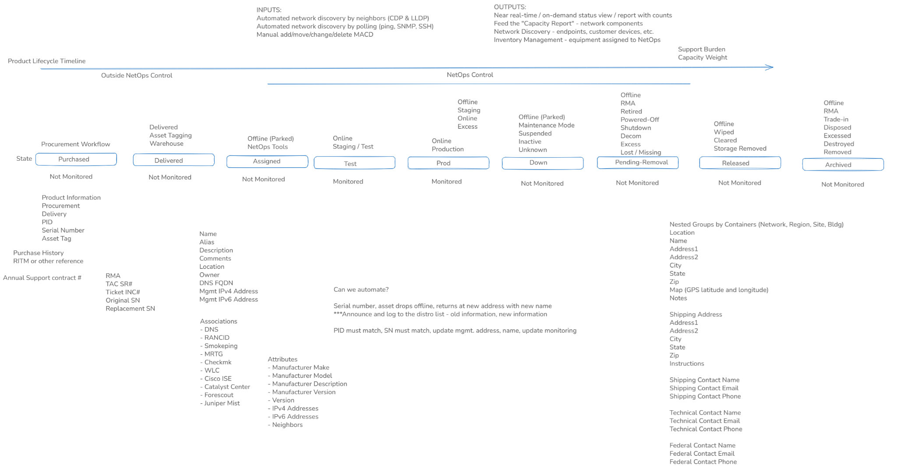

# Requirements

`hirdir` tracks the things a network operations team is responsible for, from the
purchase request to the day the item leaves the organization. It answers: what do we
have, where is it, who answers for it, what does it cost to keep supported, how much
work is it to support, and when must it be replaced.

This page says what the product must do. [data-model.md](data-model.md) defines the
records and rules, [architecture.md](architecture.md) the software and its packaging,
[interfaces.md](interfaces.md) the API, CLI, import and export, and
[build-plan.md](build-plan.md) the order of work. Choices made along the way, and the
ones still to confirm, are in [decisions.md](decisions.md).

**MUST** marks a requirement of the MVP (release 1.0.0). **LATER** marks work that is
planned after the MVP but that the MVP schema and interfaces must not block.

## What is tracked

An item earns a place in the inventory when at least one of these is true:

- it is, or could be, covered by a recurring support contract;
- it adds to the support burden of the operations team, with or without a contract.

That covers switches, routers, firewalls, wireless LAN controllers and access points,
VoIP phones, physical servers and blade chassis, virtual machines, hand-held test
equipment, and also software applications and SaaS services that carry a recurring
cost or a support burden. A Linux virtual machine with no contract still counts,
because someone has to patch it.

Not every field applies to every item, and blanks are normal. A piece of test equipment
may have only a manufacturer, a model, a serial number and an owner. More can be added
later, for example a Last Day of Support date on its model.

## Terms

| Term | Meaning |
|---|---|
| **Item** | One tracked thing: hardware, a virtual machine, a software application or a service. |
| **Major item** | An item with no parent. Major items are what is counted, and what carries support weight. |
| **Minor item** | An item installed in or attached to a major item: a power supply, a line card, a module, a blade. Not counted. |
| **Catalog entry** | One manufacturer plus product ID (PID). Holds what is true of every item of that model. |
| **Vendor** | A manufacturer or a provider of support. |
| **Device group** | A labelled set of items with roles: a switch stack, a controller cluster, a controller with its endpoints. Groups nest. |
| **Managed node** | What the network sees as one device: a standalone major item, or a stack or cluster behind one management address. |
| **HID** | The `hirdir` ID, assigned by the application to every record and never reused or changed. |
| **Lifecycle state** | Where the item is between purchase and disposal. |
| **Disposition** | What an item in hand is for: Staging, Production, Spare or Excess. |
| **Expected online** | The intent that the item is powered and reachable. What monitoring observes is a separate fact. |
| **Network** | A label for an address space: a VRF, a tenant, a coloured network. |
| **Registration** | A link from an item or group to an external system that knows it: a monitoring tool, an SDN controller, a cloud service. |
| **Purchase request** | An internal request number (RITM) with lines of model and quantity, before serial numbers exist. |
| **Effective value** | A value an item has by its own setting or by inheritance, together with where it came from. |
| **Resource unit** | The measure of capacity to do support work. Support weight is the demand for it; staff, outside services and tools are the supply. |
| **Capacity line** | One source of resource units, or one call on them other than the infrastructure. |

## Principles

1. **An item is not a discovery result.** An item still exists while it is offline,
   unmonitored, renamed or renumbered. Its HID and its history survive all of those.
2. **Set it once, inherit it everywhere, override where needed.** A value belongs on the
   most general record it is true of: a date on the model, a contact on the region, a
   discount on the global setting. A blank inherits. A local value overrides. Every
   interface shows where an effective value came from.
3. **One set of rules.** The web UI, the API, the CLI and file imports go through the
   same validation and the same permission checks on the server.
4. **Nothing is silently lost.** Every change is recorded with who, when, what was and
   what is. Items are archived, not deleted.
5. **Intent and observation are separate.** The inventory records what should be. A
   later release compares that with what discovery and monitoring report.

## Functional requirements

### R1 Items and the catalog

- **R1.1** Every record MUST have an HID. Exports always include it, and an import that
  carries an HID updates that record and no other.
- **R1.2** Manufacturer, PID and serial number together identify a physical item and
  MUST be unique when a serial number is present.
- **R1.3** MAC address MUST be a first-class field: stored in one normalized form,
  accepted in any common notation, searchable in whole or in part. It is not required to
  be unique.
- **R1.4** Asset tag is optional. An item with no serial number is tracked by its name.
  An item with no name takes its hostname as its name.
- **R1.5** The catalog MUST hold, per manufacturer and PID: kind, type, function,
  description, End of Sale, End of Software Support, End of Hardware Support and Last
  Day of Support dates, estimated value, support weight, recurring annual support cost,
  and stack discount.
- **R1.6** An item inherits value, support weight, annual support cost and the four
  dates from its catalog entry. Any of them MAY be overridden on the item, for the unit
  that has extra licensing, prepaid support or added components.
- **R1.7** Estimated value is a planning figure. It is not the price paid and not the
  replacement cost, and it MAY be blank.
- **R1.8** The catalog MUST accept entries that are not hardware: a virtual machine
  template, a software application, a SaaS service. Items of those kinds carry weight
  and cost like any other.
- **R1.9** Tags MUST be attachable to catalog entries, items, device groups, regions,
  sites, locations, contracts, contacts and owners, and searchable on all of them.

### R2 Major and minor items

- **R2.1** A minor item MUST reference exactly one parent. A minor item MAY itself have
  minor items (a module in a blade in a chassis). Cycles are refused.
- **R2.2** A minor item inherits location, owner, lifecycle state, disposition and
  expected-online from its parent unless it sets its own.
- **R2.3** A minor item MAY have its own serial number, catalog entry and contract
  coverage, and MAY have its own hostname and addresses (a blade server).
- **R2.4** Removing a minor item from its parent (a pulled power supply, a line card
  moved to another chassis) MUST keep its record and its history.

### R3 Device groups

- **R3.1** A **stack** has two or more major items, exactly one of which is the master.
  The stack carries the hostname and management addresses. The serial number shown for
  the stack is the master's, read through, not stored.
- **R3.2** Each stack member keeps its own serial number, catalog entry, contract
  coverage and lifecycle. Support contract cost for a stack is the sum of its members,
  with no discount.
- **R3.3** Support weight for a stack member is reduced by the stack discount of its
  model. The discount is set globally and MAY be overridden per catalog entry.
- **R3.4** A **cluster** groups controllers or other devices that present one management
  address while a standby is unreachable until failover. Each member is still a major
  item and is counted.
- **R3.5** A **controller domain** relates one or more controllers, or a cluster of
  them, to the endpoints they manage: access points to a wireless LAN controller, phones
  to a call-control cluster. An endpoint MAY be standalone.
- **R3.6** Groups MUST nest: a controller domain may contain a cluster.
- **R3.7** Membership changes MUST be recorded with dates, so that the stack a switch
  belonged to last year can be answered.

### R4 Lifecycle, disposition and intent

- **R4.1** The lifecycle states are Purchased, Delivered, Assigned, Test, Prod, Down,
  Pending-Removal, Released and Archived.
- **R4.2** An item in hand MUST carry a disposition (Staging, Production, Spare, Excess)
  and an expected-online flag. A switch can be online in production, online as a spare,
  offline as a spare, online or offline in staging. Excess is always offline.
- **R4.3** Which transitions and which combinations are valid MUST be data, editable by
  an administrator, not code.
- **R4.4** A state change records who, when, from, to and why. A bulk change shows a
  preview before it is applied.
- **R4.5** Replacing an item, for an RMA, a project or a technology refresh, MUST link
  two records: the item that left and the item that took its place.
- **R4.6** Archived items stay in the database. They are hidden from default views and
  shown greyed out when the viewer asks to include them.
- **R4.7** Any item, site or location MAY be held as a **draft**: entered ahead of time
  and left out of counts until it is made active. The MVP stores and honours the flag;
  planning views that work with drafts are LATER.

### R5 Purchases

- **R5.1** A purchase request MUST record its reference (RITM), and lines of catalog
  entry, quantity, destination and expected date, before any serial number is known.
- **R5.2** A line stays pending until delivery is assured. Receiving a line creates its
  items, with serial numbers and asset tags entered or imported then.
- **R5.3** Pending lines are not counted as inventory. They appear in planning reports.

### R6 Counting, support weight and value

- **R6.1** The **component count** is the number of active major items. Each stack
  member and each cluster member counts once. Minor items do not count.
- **R6.2** The **managed-node count** is the number of things the network sees as one
  device. A stack counts once and a cluster counts once. Reports MUST show both counts
  side by side, because discovery tools report the second and budgets need the first.
- **R6.3** **Support weight** of a major item is its effective weight, multiplied by one
  minus the stack discount when it is a stack member. Minor items carry no weight.
- **R6.4** Phones and access points are major items and are counted.
- **R6.5** Totals of count, weight, estimated value and annual support cost MUST be
  available by vendor, kind, type, function, region, site, owner, lifecycle state,
  disposition, contract and tag.

### R7 Geography, contacts and owners

- **R7.1** Regions nest to any depth. A site belongs to one region. A location belongs
  to one site and MAY nest within the site (building, floor, room, rack).
- **R7.2** An item is placed at a location. Its site and region path are derived.
- **R7.3** Contacts are reusable records attached to a region, site or location in a
  role: shipping, technical, federal, operational, escalation. A location with no
  contact of its own for a role inherits the nearest ancestor's.
- **R7.4** Shipping address and shipping instructions inherit the same way. An address
  is inherited or overridden as a whole, never field by field. GPS coordinates do not
  inherit.
- **R7.5** Owner is a reference to a managed owner record with a primary and alternate
  people. An owner outside the operations team is allowed as a marked exception with a
  reason.
- **R7.6** Moving a site or a region subtree changes derived paths and inherited values
  and is audited. It does not change any item's identity.

### R8 Contracts and vendors

- **R8.1** A contract has a number, a vendor, coverage dates, a status and notes, and
  covers many items. An item may be covered by several contracts over time.
- **R8.2** Warranty, contract coverage and the four end-of-life dates are separate facts
  and MUST be stored separately.
- **R8.3** A **vendor view** MUST list everything from one vendor in one place:
  hardware, virtual machines, software and services, with coverage, dates, weight and
  cost. This is the working list for annual renewal planning.
- **R8.4** Reports MUST include items in service with no coverage, coverage on items no
  longer in service, and items past or approaching each end-of-life date.

### R9 Addresses and networks

- **R9.1** An item or group MAY have several IPv4 and IPv6 addresses, one of which is
  marked as the management address.
- **R9.2** An address MAY carry a network label. The same address under two labels is
  two different addresses. A repeat under one label is reported, not refused.
- **R9.3** `hirdir` is not an IP address manager. It records addresses of tracked items
  and nothing about prefixes, pools or allocation.

### R10 Search, views and bulk work

- **R10.1** Every list MUST sort by any column, filter on any field, and page on the
  server.
- **R10.2** Filters support exact, contains, prefix, wildcard and bounded regular
  expression matching, combined with AND and OR. One filter definition serves the grid,
  the export, the API and the CLI, so an export always matches what was on screen.
- **R10.3** The grid selects whole rows. Selected rows can be copied to the clipboard as
  tab-separated text, exported, or changed in bulk after a preview.
- **R10.4** Selecting cell ranges and editing in the grid are LATER.
- **R10.5** An edit made against a stale copy of a record MUST be refused with a clear
  message, never applied over the newer change.

### R11 Import and export

- **R11.1** Every record type MUST import from and export to CSV and JSON, from the web
  UI, the API and the CLI.
- **R11.2** An import is previewed before it is applied. The preview lists creates,
  updates, unchanged rows and rejected rows with reasons.
- **R11.3** In an import, an empty cell leaves the value as it is. Clearing a value
  takes an explicit marker.
- **R11.4** Importing the same file twice MUST change nothing the second time.
- **R11.5** A reference to a manufacturer and PID that is not yet in the catalog creates
  the catalog entry, marked for review, so an import never stalls on catalog upkeep.

### R12 Access

- **R12.1** Nothing but the login page and the health check is reachable without
  signing in.
- **R12.2** The roles are **View-only**, **Inventory** (full access to inventory data)
  and **Admin** (Inventory plus accounts, groups and role assignment).
- **R12.3** Users belong to user groups. A group is a label by default. A role MAY be
  granted to a user or to a group, and a user holds the highest role granted by either.
- **R12.4** The MVP signs in with a username and an access code set by an Admin. Code
  length and complexity rules are LATER. RADIUS, then SAML, are LATER.
- **R12.5** The browser MUST NOT be sent cookies. The session token lives in local
  browser storage.
- **R12.6** An Admin MUST be able to end every session of a user at once.
- **R12.7** Automation uses tokens that belong to service accounts, never to people.

### R13 Integration

- **R13.1** Everything the web UI can do MUST be available through the versioned API,
  and the CLI MUST be a client of that API.
- **R13.2** An external system (monitoring, configuration backup, access control, SDN
  controller, cloud service) is a record, and an item or group MAY be registered with
  any number of them.
- **R13.3** LATER: accept observations from discovery and monitoring, match them to
  items by manufacturer, PID and serial number, and propose updates when a known item
  reappears with a new name or address. A mismatch opens a review item. Absence from
  discovery never changes lifecycle state.
- **R13.4** LATER: publish changes outward, as a change feed, as host lists for
  monitoring tools, and as notices to a distribution list.

### R14 Capacity planning

The purpose is a conversation with managers and contractors about the right number of
positions on the operations team, given outside help, automation and newer inputs such
as AI.

- **R14.1** The support weight of the infrastructure (R6.3) is the **demand** it places
  on the team, expressed in resource units.
- **R14.2** **Supply** is entered as capacity lines, each in a category:
  - **Staff**: full-time positions on the operations team, one line for each kind or
    level of position.
  - **Professional services**: support staff outside the team, such as a vendor's
    advanced services or a partner contractor held for escalation.
  - **Smart hands**: on-site physical work done by a colocation provider on a ticket,
    billed by the hour.
  - **Tools**: what automation and tooling contribute, as one number or several.
  - **Services**: one or more add-on services, agentic AI among them.
- **R14.3** A line has a name, a quantity, the resource units each one provides, and
  optionally an annual cost, a vendor, start and end dates, and a region or site it
  serves.
- **R14.4** The sum of the supply lines is the resource units available. They support
  the infrastructure and also do other work. Projects, a merger or acquisition, an
  organizational transition and the like keep people busy beyond day-to-day support, so
  each is entered as a demand line of its own.
- **R14.5** The capacity report MUST show demand, supply by category, the balance and
  the ratio between them, and how much of the supply is the team's own positions against
  outside assistance, tools and services.
- **R14.6** A line MAY be a draft. The report compares the balance with and without the
  drafts, which answers "what if we add this service" or "what if that contract ends".
- **R14.7** LATER: a dated record of the balance, to show the trend.
- **R14.8** LATER: a line that multiplies the capacity of chosen staff lines instead of
  adding a fixed amount, for tools and AI that make people more effective.

## Qualities

| Quality | Target |
|---|---|
| Scale | 50,000 items, of which 15,000 are major items that are not phones, with 25 people signed in. |
| Response | A sorted, filtered page of the item grid returns in under 300 ms at that scale on the reference host. |
| Import | 10,000 rows preview in under 30 s and apply in under 60 s. |
| Availability | One host. A restart loses no committed change. |
| Recovery | A backup restores to a clean host with one documented command. |
| Ease | Nothing a person does waits on the application where that can be avoided. The first page is small, and pages open without a visible load. |
| Times | Shown in the application's time zone with the zone named, the same for everybody. America/New_York unless an Admin sets another. |
| Audit | Every change is kept. Nothing expires before a retention feature exists. |
| Browser | Current Firefox, Chrome and Edge. Keyboard reachable, visible focus, labelled inputs. |

## Security posture

`hirdir` is built so that it can sit inside a regulated enterprise, a federal one
included, without claiming to satisfy any control catalogue by itself. The split is:

| Area | Inside `hirdir` | Provided by the host environment |
|---|---|---|
| Identification and authentication | Accounts, access codes, signed session tokens, service tokens, sign-in throttling. LATER: RADIUS, SAML. | The identity provider, multi-factor policy, account lifecycle. |
| Access control | Three roles, checked on the server for every request. | Network reachability, who may reach the URL at all. |
| Audit | A complete record of every change and every sign-in. | Log forwarding, retention policy, review. |
| Protection in transit | Bearer tokens only, a strict content security policy, same-origin requests. | TLS, certificates and cipher policy, in nginx. |
| Configuration and integrity | A signed-off release, pinned dependencies, a versions table per release. | Host hardening, patching, package signing, backups off the host. |

## Not in scope

- IP address management, cabling, rack elevation, power and interface inventory.
- Polling devices. `hirdir` receives observations from tools that already poll.
- Replacing a monitoring system, a configuration backup tool or a service desk.
- Tracking endpoints that the operations team does not support, such as user laptops.
- Depreciation, purchase accounting or actual prices paid.
- Scheduling, time tracking or personnel records. A staff line is a number of positions,
  not a person.

## Example data

Every example in this repository is fictional. Host names, serial numbers, asset tags,
contract numbers, people, sites and counts are invented, and addresses come from the
ranges reserved for documentation (`192.0.2.0/24`, `198.51.100.0/24`, `203.0.113.0/24`,
`2001:db8::/32`). Manufacturer and model names are real, because a network inventory
that could not say "Catalyst 9300" would explain nothing.
