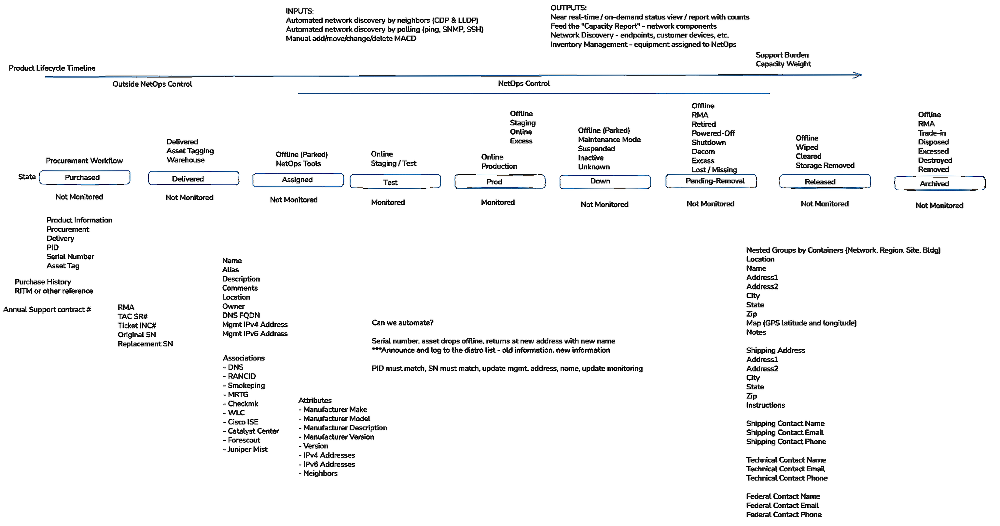

# Requirements

`hirdir` tracks the things a network operations team is responsible for, from the
purchase request to the day the item leaves the organization. It answers: what do we
have, where is it, who answers for it, what does it cost to keep supported, how much
work is it to support, and when must it be replaced.

This page says what the product must do. [data-model.md](data-model.md) defines the
records and rules, [architecture.md](architecture.md) the software and its packaging,
[interfaces.md](interfaces.md) the API, CLI, import and export, and
[build-plan.md](build-plan.md) the order of work. Choices made along the way, and the
ones still to confirm, are in [decisions.md](decisions.md).

**MUST** marks a requirement of the MVP (release 1.0.0). **LATER** marks work that is
planned after the MVP but that the MVP schema and interfaces must not block. The
releases from 0.6.1 to 0.9.0 come before the MVP: what each adds is in
[build-plan.md](build-plan.md) under "From 0.6.1 to 0.9.0", and is written into this
page as requirements when the release is started.

## What is tracked

An item earns a place in the inventory when at least one of these is true:

- it is, or could be, covered by a recurring support contract;
- it adds to the support burden of the operations team, with or without a contract.

That covers switches, routers, firewalls, wireless LAN controllers and access points,
VoIP phones, physical servers and blade chassis, virtual machines, hand-held test
equipment, and also software applications and SaaS services that carry a recurring
cost or a support burden. A Linux virtual machine with no contract still counts,
because someone has to patch it.

Not every field applies to every item, and blanks are normal. A piece of test equipment
may have only a manufacturer, a model, a serial number and an owner. More can be added
later, for example a Last Day of Support date on its model.

Beside the items, from 0.8.0, `hirdir` keeps the telecommunication circuits the team
looks after: the circuits that connect its sites to each other, to carriers and to
cloud services, with their carriers, their monthly cost and the devices at each end
(R15). A circuit is not an item and is in no component count.

## Terms

| Term | Meaning |
|---|---|
| **Item** | One tracked thing: hardware, a virtual machine, a software application or a service. |
| **Major item** | An item with no parent. Major items are what is counted, and what carries support weight. |
| **Minor item** | An item installed in or attached to a major item: a power supply, a line card, a module, a blade. Not counted. |
| **Catalog entry** | One manufacturer plus product ID (PID). Holds what is true of every item of that model. |
| **Vendor** | A manufacturer or a provider of support. |
| **Device group** | A labelled set of items with roles: a switch stack, a controller cluster, a controller with its endpoints. Groups nest. |
| **Managed node** | What the network sees as one device: a standalone major item, or a stack or cluster behind one management address. |
| **HID** | The `hirdir` ID, assigned by the application to every record and never reused or changed. |
| **Lifecycle state** | Where the item is between purchase and disposal. |
| **Disposition** | What an item in hand is for: Staging, Production, Spare or Excess. |
| **Expected online** | The intent that the item is powered and reachable. What monitoring observes is a separate fact. |
| **Condition** | The state of an item's hardware as a person knows it: untested, good, degraded, suspect, failed or dead. It holds while the item is on a shelf. |
| **Observed status** | What is seen of an item or a group: online, degraded or unreachable on the network, or present, seen by a person where it should be. Set by hand or by an import until a monitoring tool writes it. |
| **Health** | What the condition, the observed status and the intent say together, as good, degraded, failed or unknown. For a stack or a cluster it follows from its members, and is worked out when read. |
| **Owner** | The part of the organization that answers for an item: a team, a service, an outside party. It has its people, a primary and alternates. |
| **Contact** | A person, or a shared mailbox, once: the name, the email and the numbers that every part a person plays reads. A user, who signs in, and an operator, who looks after what a label is on, are each such a part, and add only what is their own. |
| **Operator** | A short label, initials or a code, that stands for the one member of the operations team who looks after what it is on: its steward. Given to an item, to a device group for all its members, or to a place for everything there. The person behind a label is changed in one place. |
| **Network** | A label for an address space: a VRF, a tenant, a coloured network. |
| **Registration** | A link from an item or group to an external system that knows it: a monitoring tool, an SDN controller, a cloud service. |
| **Purchase request** | An internal request number (RITM) with lines of model and quantity, before serial numbers exist. |
| **Effective value** | A value an item has by its own setting or by inheritance, together with where it came from. |
| **Resource unit** | The measure of capacity to do support work. Support weight is the demand for it; staff, outside services and tools are the supply. |
| **Capacity line** | One source of resource units, or one call on them other than the infrastructure. |

## Principles

1. **An item is not a discovery result.** An item still exists while it is offline,
   unmonitored, renamed or renumbered. Its HID and its history survive all of those.
2. **Set it once, inherit it everywhere, override where needed.** A value belongs on the
   most general record it is true of: a date on the model, a contact on the region, a
   discount on the global setting. A blank inherits. A local value overrides. Every
   interface shows where an effective value came from.
3. **One set of rules.** The web UI, the API, the CLI and file imports go through the
   same validation and the same permission checks on the server.
4. **Nothing is silently lost.** Every change is recorded with who, when, what was and
   what is. Items are archived, not deleted. Two exceptions are made. An Admin deletes
   an item or a device group that was a mistake and that nothing else depends on, and
   the audit trail keeps the record as it was, the reason, and every event it had
   before (P-227). And an operator on the server itself clears a trial inventory with
   `hirdir admin reset`, which takes a backup first.
5. **Intent and observation are separate.** The inventory records what should be. What
   is observed is kept beside it, as its own fact with the moment it was seen, and the
   two are compared. Until discovery and monitoring report it, what is observed is
   entered by hand or by an import.

## Functional requirements

### R1 Items and the catalog

- **R1.1** Every record MUST have an HID. Exports always include it, and an import that
  carries an HID updates that record and no other.
- **R1.2** Manufacturer, PID and serial number together identify a physical item and
  MUST be unique when a serial number is present.
- **R1.3** MAC address MUST be a first-class field: stored in one normalized form,
  accepted in any common notation, searchable in whole or in part. It is not required to
  be unique.
- **R1.4** Asset tag is optional. An item with no serial number is tracked by its name.
  An item with no name takes its hostname as its name.
- **R1.5** The catalog MUST hold, per manufacturer and PID: kind, type, function,
  description, End of Sale, End of Software Support, End of Hardware Support and Last
  Day of Support dates, estimated value, support weight, recurring annual support cost,
  and stack discount.
- **R1.6** An item inherits value, support weight, annual support cost and the four
  dates from its catalog entry. Any of them MAY be overridden on the item, for the unit
  that has extra licensing, prepaid support or added components.
- **R1.7** Estimated value is a planning figure. It is not the price paid and not the
  replacement cost, and it MAY be blank.
- **R1.8** The catalog MUST accept entries that are not hardware: a virtual machine
  template, a software application, a SaaS service. Items of those kinds carry weight
  and cost like any other.
- **R1.9** Tags MUST be attachable to catalog entries, items, device groups, regions,
  sites, locations, contracts, contacts and owners, and searchable on all of them.
- **R1.10** A catalog entry, a region, a site and a location MAY carry links, each a
  web address and the text to show for it: the data sheet of a model, the web page of
  a site. An item MUST show the links of its model. Links travel in files, and an
  address that is not a web address is refused.

### R2 Major and minor items

- **R2.1** A minor item MUST reference exactly one parent. A minor item MAY itself have
  minor items (a module in a blade in a chassis). Cycles are refused.
- **R2.2** A minor item inherits location, owner, lifecycle state, disposition and
  expected-online from its parent unless it sets its own.
- **R2.3** A minor item MAY have its own serial number, catalog entry and contract
  coverage, and MAY have its own hostname and addresses (a blade server).
- **R2.4** Removing a minor item from its parent (a pulled power supply, a line card
  moved to another chassis) MUST keep its record and its history.

### R3 Device groups

- **R3.1** A **stack** has one or more major items. One of them MAY be marked as the
  master that is intended. Which member is master at a given time is decided by the
  stack and may change, so the master that is seen is recorded apart from the one
  intended. The stack carries the hostname and management addresses. The serial number
  shown for the stack is that of the master seen, or else of the one intended, read
  through, not stored, and a stack is found by the serial number of any member.
- **R3.2** Each stack member keeps its own serial number, catalog entry, contract
  coverage and lifecycle. Support contract cost for a stack is the sum of its members,
  with no discount.
- **R3.3** Support weight for a stack member is reduced by the stack discount of its
  model. The discount is set globally and MAY be overridden per catalog entry.
- **R3.4** A **cluster** groups controllers or other devices that present one management
  address while a standby is unreachable until failover. Each member is still a major
  item and is counted.
- **R3.5** A **controller domain** relates one or more controllers, or a cluster of
  them, to the endpoints they manage: access points to a wireless LAN controller, phones
  to a call-control cluster. An endpoint MAY be standalone.
- **R3.6** Groups MUST nest: a controller domain may contain a cluster.
- **R3.7** Membership changes MUST be recorded with dates, so that the stack a switch
  belonged to last year can be answered.

### R4 Lifecycle, disposition and intent

- **R4.1** The lifecycle states are Purchased, Delivered, Assigned, Test, Prod, Down,
  Pending-Removal, Released and Archived.
- **R4.2** An item in hand MUST carry a disposition (Staging, Production, Spare, Excess)
  and an expected-online flag. A switch can be online in production, online as a spare,
  offline as a spare, online or offline in staging. Excess is always offline.
- **R4.3** Which transitions and which combinations are valid MUST be data, editable by
  an administrator, not code.
- **R4.4** A state change records who, when, from, to and why. A bulk change shows a
  preview before it is applied.
- **R4.5** Replacing an item, for an RMA, a project or a technology refresh, MUST link
  two records: the item that left and the item that took its place.
- **R4.6** Archived items stay in the database. They are hidden from default views and
  shown greyed out when the viewer asks to include them.
- **R4.7** Any item, site or location MAY be held as a **draft**: entered ahead of time
  and left out of counts until it is made active. The MVP stores and honours the flag;
  planning views that work with drafts are LATER.

### R5 Purchases

- **R5.1** A purchase request MUST record its reference (RITM), and lines of catalog
  entry, quantity, destination and expected date, before any serial number is known.
- **R5.2** A line stays pending until delivery is assured. Receiving a line creates its
  items, with serial numbers and asset tags entered or imported then.
- **R5.3** Pending lines are not counted as inventory. They appear in planning reports.
- **R5.4** A request MAY hold lines of what the inventory does not follow, kept with
  the part number and description that procurement gave them. A line with no model is
  not tracked: it takes no item, is in no count and does not hold the request open. A
  file of lines matches each part number to the catalog and never makes a catalog
  entry; a part number that matches no model, or more than one, leaves its line
  untracked and says why.
- **R5.5** The model of a line MUST be correctable at any time. Where items have
  arrived on it, the person correcting it says whether they take the corrected model
  too.

### R6 Counting, support weight and value

- **R6.1** The **component count** is the number of active major items. Each stack
  member and each cluster member counts once. Minor items do not count.
- **R6.2** The **managed-node count** is the number of things the network sees as one
  device. A stack counts once and a cluster counts once. Reports MUST show both counts
  side by side, because discovery tools report the second and budgets need the first.
- **R6.3** **Support weight** of a major item is its effective weight, multiplied by one
  minus the stack discount when it is a stack member. Minor items carry no weight.
- **R6.4** Phones and access points are major items and are counted.
- **R6.5** Totals of count, weight, estimated value and annual support cost MUST be
  available by vendor, kind, type, function, region, site, owner, lifecycle state,
  disposition, contract and tag.

### R7 Geography, contacts and owners

- **R7.1** Regions nest, up to sixteen deep. A site belongs to one region. A location belongs
  to one site and MAY nest within the site (building, floor, room, rack).
- **R7.2** An item is placed at a location. Its site and region path are derived.
- **R7.3** Contacts are reusable records attached to a region, site or location in a
  role: shipping, technical, federal, operational, escalation. A location with no
  contact of its own for a role inherits the nearest ancestor's.
- **R7.4** Shipping address and shipping instructions inherit the same way. An address
  is inherited or overridden as a whole, never field by field. GPS coordinates do not
  inherit.
- **R7.4a** The coordinates of a site or a location open a map, at an address that a
  setting names and an installation may change or blank; with it blank they are plain
  numbers, as where there is no access to the internet (P-229).
- **R7.4b** The country of every address, and its state where its country has states
  listed, MUST be chosen from lists that an Admin keeps, stored as their ISO 3166 codes
  and shown by their names, the United States first and read as the country of an
  address that names none, so that what one person types matches what another typed
  (P-318, P-321).
- **R7.5** Owner is a reference to a managed owner record with a primary and alternate
  people. An owner outside the operations team is allowed as a marked exception with a
  reason.
- **R7.5a** An item, a device group or a place MAY be assigned an operator: a label
  that stands for a named member of the team who looks after it. The members of a
  group have the operator of the group, and what is at a place the operator of the
  place, unless they are given their own. The person behind a label MUST be
  changeable in one step, the label MAY stand open while nobody is behind it, and it
  MAY be released. What nobody is assigned to MUST be easy to list, because a device
  with no named steward is one that nobody feels responsible for.
- **R7.6** Moving a site or a region subtree changes derived paths and inherited values
  and is audited. It does not change any item's identity.

### R8 Contracts and vendors

- **R8.1** A contract has a number, a vendor, coverage dates, a status and notes, and
  covers many items. An item may be covered by several contracts over time.
- **R8.2** Warranty, contract coverage and the four end-of-life dates are separate facts
  and MUST be stored separately.
- **R8.3** A **vendor view** MUST list everything from one vendor in one place:
  hardware, virtual machines, software and services, with coverage, dates, weight and
  cost. This is the working list for annual renewal planning.
- **R8.4** Reports MUST include items in service with no coverage, coverage on items no
  longer in service, and items past or approaching each end-of-life date.
- **R8.5** A **renewal worklist** MUST list what a person has to act on: the contracts
  that end within the warning period, those that have lapsed, those whose renewal is
  pending, for how long and whether overdue, and the items under more than one
  contract, each under its vendor and its agreement, each count leading to its rows. It
  is a page, a report and a command.
- **R8.6** A person with the Inventory or the Admin role MUST be told after signing in
  how many contracts have lapsed, are pending renewal or end within the warning
  period, once until something new comes onto one of those lists.
- **R8.7** An agreement whose contracts share its period is renewed with them in one
  change: each member keeps its number, takes a new one that begins with the new
  term, or ends with the present term. A contract's history MUST show the period it
  had in each part of it, also across joining or leaving an agreement.
- **R8.8** A model, or a single item, MAY be flagged as not to be renewed. A renewal
  leaves such an item behind, its lack of cover is not a gap, and what is left out on
  purpose MUST be listed and counted by model.
- **R8.9** An agreement and a contract MAY name any number of account managers and
  support contacts as contact records, beside free text. A contract that names none of
  a role has those of its agreement, with the source shown.

### R9 Addresses and networks

- **R9.1** An item or group MAY have several IPv4 and IPv6 addresses, one of which is
  marked as the management address.
- **R9.2** An address MAY carry a network label. The same address under two labels is
  two different addresses. A repeat under one label is reported, not refused.
- **R9.3** `hirdir` is not an IP address manager. It records addresses of tracked items
  and nothing about prefixes, pools or allocation.

### R10 Search, views and bulk work

- **R10.1** Every list MUST sort by any column, filter on any field, and page on the
  server.
- **R10.2** Filters support exact, contains, prefix, wildcard and bounded regular
  expression matching, combined with AND and OR. One filter definition serves the grid,
  the export, the API and the CLI, so an export always matches what was on screen.
- **R10.3** The grid selects whole rows, by the row and by a box at its left, with one
  box in the heading for every row on show (P-233). Selected rows can be copied to the
  clipboard as tab-separated text, exported, or changed in bulk after a preview. The
  selected rows of the lists of items and of device groups are retired at once by the
  Inventory role, after being asked with their number, and never all that match a
  filter (P-228); an Admin deletes those that were a mistake (P-227).
- **R10.4** Selecting cell ranges and editing in the grid are LATER.
- **R10.5** An edit made against a stale copy of a record MUST be refused with a clear
  message, never applied over the newer change.
- **R10.6** A value of a business rule that a site could reasonably want otherwise
  MUST be a setting with a default built in, listed with its default and description
  and returned to it by one change. A limit that protects the service MAY stay fixed,
  and is then listed as fixed. The application MUST be able to write a complete
  configuration file, every key with its default and description.
- **R10.7** LATER: a person MAY choose the colour theme of the web page. One who has
  chosen none sees the default. The choice is kept in the browser's local storage and
  never in a cookie (P-144).
- **R10.8** A value of a list that names another record MUST open that record: the
  group, the place, the owner, the operator, the vendor and the model of an item, and
  likewise in every other list. It looks like the text around it and is underlined
  under the pointer and with the keyboard's focus (P-232).
- **R10.9** What is typed or pasted MUST be put into one form by formats an Admin turns
  on and defines, each a setting: a telephone number written in the first of the
  patterns an Admin chooses that fits its digits, none until one is chosen; an email
  address in lower case; and, on the web page alone, a person's name in Title Case
  where it was typed in lower case, never lowering a capital that was typed. The
  server applies the first two to what comes by the API, a file and the command line
  as well as the page. Pasting is never hindered: a value is taken as it is pasted and
  written again in the format, and one that no format fits, such as a number with an
  extension, is kept as typed, never refused (P-293, P-322).

### R11 Import and export

- **R11.1** Every record type MUST import from and export to CSV and JSON, from the web
  UI, the API and the CLI.
- **R11.2** An import is previewed before it is applied. The preview lists creates,
  updates, unchanged rows and rejected rows with reasons. A value that an input format
  writes in another form is shown as it will be saved, beside the value in the file,
  so that what an import would tidy is seen before it is applied (P-322).
- **R11.3** In an import, an empty cell leaves the value as it is. Clearing a value
  takes an explicit marker.
- **R11.4** Importing the same file twice MUST change nothing the second time.
- **R11.5** A reference to a manufacturer and PID that is not yet in the catalog creates
  the catalog entry, marked for review, so an import never stalls on catalog upkeep.
  A file of purchase lines is the exception (R5.4).
- **R11.6** Applying a large file MUST NOT stop other people's work. It is applied in
  the background, in batches, with its progress shown; a row whose record changed
  after the preview is not applied and is reported, while the rest are; and an apply
  that stops partway says what was applied and is resumed.
- **R11.7** A past import lists the records it made, each with what it is now, and
  those that were made only because a row named them. Where they are items or device
  groups, the Inventory role retires the rows it selects and an Admin deletes those
  that should never have been (P-234, P-227, P-228).
- **R11.8** A place is found in a file by its path of names, by its HID, or by codes:
  a step of the path may be a code, a path may begin at the code of a region or a
  site, and a location is found by its code after its site. An export writes places by
  their codes where it is asked to (P-235).
- **R11.9** Every table that a file is taken for is exported from the page that takes
  the files, with how many records it holds, one table or all of them at once; a table
  that holds nothing exports as the template of its import. What is exported, loaded
  back into the inventory it came from, MUST change nothing (P-286, P-287).
- **R11.10** An Admin exports the users as CSV. No file holds an access code, a token
  or a hash of either, and no file makes or changes a user (P-288).

### R12 Access

- **R12.1** Nothing but the login page and the health check is reachable without
  signing in.
- **R12.2** The roles are **View-only**, **Inventory** (full access to inventory data)
  and **Admin** (Inventory plus accounts, groups and role assignment).
- **R12.3** Users belong to user groups. A group is a label by default. A role MAY be
  granted to a user or to a group, and a user holds the highest role granted by either.
  A user who holds no role does not sign in, and is told so with whom to ask; a person
  is given a role when the account is made and when it is brought back (P-299).
- **R12.4** The MVP signs in with a username and an access code set by an Admin. Code
  length and complexity rules are LATER. RADIUS, then SAML, are LATER.
- **R12.5** The browser MUST NOT be sent cookies. The session token lives in local
  browser storage.
- **R12.6** An Admin MUST be able to end every session of a user at once.
- **R12.7** Automation uses tokens that belong to service accounts and agents, never to
  people.
- **R12.8** An Admin makes a user, the contact it is and the operator it works as in
  one step, with its role and its groups, and changes a user's groups and notes from
  the user's own page. The lists of users, of contacts and of operators each say which
  of the other two a person is, as a link, and each is narrowed to those that are not
  (P-280 to P-284).
- **R12.9** A person who signs in changes what is their own on a profile page, reached
  from their name in the menu bar: the name, email, numbers and organization of the
  contact they are, the label and colour of each operator they are behind, and their
  access code, for which the code they have is asked. Every role does this for itself
  and nobody for another. A typed access code has a least length, which a setting says
  (P-289, P-294, P-295). A new code is not the one it replaces, and the server makes one
  where asked, on the profile and on an Admin's forms, as long as the setting asks
  (P-300).
- **R12.10** A user account is active, disabled or retired. A retired account is that
  of somebody who has left: it signs in with nothing, holds no role and is in no group,
  keeps its username, and is left out of the list of users, of every picker and of the
  users' file until the retired are asked for. An Admin retires an account and brings
  one back (P-292, P-296).
- **R12.11** The user, the contact and the operators of one person are shown as a
  chain on the page of each, and a retirement of one says what becomes of each of the
  others, in one confirmation and one change, or is refused with them named. A contact
  is not retired while its account or a label stands on it. A retired user, contact or
  operator is brought back by an Admin alone (P-291, P-297, P-298).
- **R12.12** An account is a person's, a service's or an agent's. A service does a fixed
  job, application to application; an agent decides what to change, as a person does.
  An agent is made by an Admin, is answerable to a person who holds a role, holds
  tokens alone, is never Admin and holds no more than the role of that person as it is
  at each request; what it changes is marked in the audit trail with the person it was
  answerable to, and the person's retirement says what becomes of each of their agents
  (P-316).
- **R12.13** A user's page says each role the account holds and where it comes from, of
  its own or through which group, and a change that would leave an account with no role
  says so before it is made (P-307, P-314).

### R13 Integration

- **R13.1** Everything the web UI can do MUST be available through the versioned API,
  and the CLI MUST be a client of that API.
- **R13.2** An external system (monitoring, configuration backup, access control, SDN
  controller, cloud service) is a record, and an item or group MAY be registered with
  any number of them.
- **R13.3** LATER: accept observations from discovery and monitoring, match them to
  items by manufacturer, PID and serial number, and propose updates when a known item
  reappears with a new name or address. A mismatch opens a review item. Absence from
  discovery never changes lifecycle state.
- **R13.4** LATER: publish changes outward, as a change feed, as host lists for
  monitoring tools, and as notices to a distribution list.

### R14 Capacity planning

The purpose is a conversation with managers and contractors about the right number of
positions on the operations team, given outside help, automation and newer inputs such
as AI.

- **R14.1** The support weight of the infrastructure (R6.3) is the **demand** it places
  on the team, expressed in resource units.
- **R14.2** **Supply** is entered as capacity lines, each in a category:
  - **Staff**: full-time positions on the operations team, one line for each kind or
    level of position.
  - **Professional services**: support staff outside the team, such as a vendor's
    advanced services or a partner contractor held for escalation.
  - **Smart hands**: on-site physical work done by a colocation provider on a ticket,
    billed by the hour.
  - **Tools**: what automation and tooling contribute, as one number or several.
  - **Services**: one or more add-on services, agentic AI among them.
- **R14.3** A line has a name, a quantity, the resource units each one provides, and
  optionally an annual cost, a vendor, start and end dates, and a region or site it
  serves.
- **R14.4** The sum of the supply lines is the resource units available. They support
  the infrastructure and also do other work. Projects, a merger or acquisition, an
  organizational transition and the like keep people busy beyond day-to-day support, so
  each is entered as a demand line of its own.
- **R14.5** The capacity report MUST show demand, supply by category, the balance and
  the ratio between them, and how much of the supply is the team's own positions against
  outside assistance, tools and services.
- **R14.6** A line MAY be a draft. The report compares the balance with and without the
  drafts, which answers "what if we add this service" or "what if that contract ends".
- **R14.7** A record of the balance each week, taken by the server each Monday and
  again by hand, shows the trend as a graph. The figures of a week MAY be corrected by
  hand, with a note, and the correction is shown.
- **R14.8** A line MAY multiply the capacity of chosen staff lines instead of adding a
  fixed amount, for tools and AI that make people more effective.
- **R14.9** The balance is of the whole operations team, whose tools and services are
  shared by every region. Beside it the report MUST show how the demand splits by
  region, and divide no supply.
- **R14.10** A region, a site and a location MAY carry a support weight of their own,
  the work a place adds by itself beside what its devices weigh: distance and time
  zones, a language the team does not speak, a campus spread across a metro area, a
  restricted site that needs clearances. It is demand, and is not inherited by the
  places beneath (P-139, P-155).
- **R14.11** An Admin MAY set, for sites, for major items and for circuits, a default
  support weight, counted where an object of the kind has none, and a minimum, which
  raises a weight below it. The counts MUST show where a weight came from a default and
  where it was raised (P-141, P-155).
- **R14.12** The capacity report MUST offer a what-if, Try, that answers the balance
  other defaults and minimums, another weight per engineer, another stack discount and
  staff lines added, changed or left out would give, beside the balance in force,
  saving nothing and auditing nothing (P-156).
- **R14.13** The capacity balance and the other long reports MUST be worked out ahead,
  each night, when the service starts and, by day, once nothing has changed for a
  time that a setting says, by the process of the background work and not by the one
  that answers people, and given to every session alike while nothing has changed
  them; an Admin MUST be able to check what is kept against answers worked out anew,
  which says what differed (P-142, P-157, P-275, P-276).

### R15 Circuits

A first way to track telecommunication circuits beside the device inventory. A
circuit shares what the inventory already holds: its ends are locations, with their
sites, addresses and site contacts; its carriers are vendors; its contacts are contact
records; its owner is an owner; its devices are items and device groups.

- **R15.1** A circuit has a name, a description and notes, and MAY have the
  enterprise's own circuit ID, unique where it is given, also where no carrier gives
  the circuit a number, as for dark fiber a business partner provides (D-158, P-145).
- **R15.2** A circuit has an A side and a Z side, each a location, or, for an end that
  is not one of the enterprise's places such as the carrier's network, no location and
  a note of where it ends; at least one side is a location (P-147). The Z side MAY
  name instead the carrier network it reaches, a carrier's private MPLS network, the
  internet, a Metro Ethernet region or a cloud on-ramp: a circuit group of the kind
  network, which lists every circuit whose Z side names it (P-319, P-320).
- **R15.3** A circuit MUST list the devices it connects, each on its side, and each
  device and each location MUST show the circuits it is on (P-147).
- **R15.4** A circuit has a primary carrier, or the other party that provides it, and
  MAY have any number of other carriers, each with its part, such as a local exchange
  carrier or the provider of a cross-connect in a co-location, and each carrier MAY give
  it a number (P-148).
- **R15.5** The account team and the support desk of a carrier are contact records
  named once on the carrier, and each of its circuits has them, with their source,
  unless it names its own. The site contacts of each side follow from its location, as
  the contacts of places resolve, with any the circuit names of its own (P-149).
- **R15.6** A circuit has a billing account number and the reference of its billing
  contract, its install and activation dates, the day it was disconnected, whether it
  carries production, its type, its speed, an optional support weight, and an owner,
  the person or team responsible for it. Who pays for it is said by a tag or a note
  (P-145, P-146). The dates are the A side's, and the Z side MAY have its own, which
  may differ, a blank one being the A side's; the dates of the side its `cost_side`
  names decide whether it is in service, the months its cost counts and whether it
  carries its support weight (P-317, P-320).
- **R15.7** A circuit's monthly recurring cost is entered as the lines the carrier
  bills, and its annual cost is twelve times their sum. Its cost and its support weight
  count at the site of its A side, or of its Z side where it is switched; an Admin
  setting gives a new circuit its side (P-150).
- **R15.8** A report MUST give the cost of circuits for a fiscal year by carrier, by
  site, by region, by group, by type, by owner and by tag, with the monthly figure
  beside it; a month in which a circuit is in service only in part counts for the days
  of it, as the carrier bills it (P-151).
- **R15.9** Circuits MAY be put into groups, a circuit into more than one, such as
  Internet access or a cloud on-ramp, and the cost of a group MUST be read as one sum
  (P-152). A group is a network, which a Z side may name, with its carrier, or a
  collection for the enterprise's own purpose; a network's circuits are those added to
  it and those whose Z side names it, each counted once (P-319, P-320).
- **R15.10** Circuits are listed, filtered, sorted and exported as items are, are
  loaded from files, where a row finds its circuit by the enterprise circuit ID, and
  are reached from the API, the command line and the web UI (P-153, P-154).
- **R15.11** Not in scope: cabling inside a building, the interfaces of a device, and
  the accounting of what was paid.

### R16 Reference files

Reference material kept with the record it is about: photographs, maps, sketches and
floor plans of a place, and the documents of a vendor for a model, served by `hirdir`
itself where a closed network has no way out to the internet.

- **R16.1** A region, a site, a location, a catalog entry, a circuit and an item MAY
  have references: each a file that is uploaded and kept by `hirdir`, or a link to one
  kept elsewhere, with a title and a kind from a list that can be edited (P-158).
- **R16.2** A reference MAY be on more than one record, and is uploaded once: an
  administration guide that covers six models is attached to all six, and a new
  edition of it replaces it on all six at once (P-158, P-160).
- **R16.3** A place MUST list its own references and then those of the places above
  it, and an item its own, those of its model and those of the places it is at, each
  with the record it comes from; nothing is copied down (P-158).
- **R16.4** A file is at most 100 MB unless a site sets another limit, and MUST be of
  a kind that an Admin allows; a web page, an SVG drawing, a script or a program is
  never taken, and a file whose content is not what its name says is refused
  (P-159).
- **R16.5** No file is served in a way that lets it run in the browser as part of the
  application: a picture is shown in the page, and every other file is downloaded
  (P-159).
- **R16.6** Any role MAY download; uploading, linking, changing, attaching, taking
  off and erasing need the Inventory role; and each of these, downloads among them, is
  an audit event (P-162).
- **R16.7** Removing a file erases its content at once; the backups on the host keep
  their copy until they are rotated out, so that each backup restores whole (P-160).
- **R16.8** The files MUST be in the backup, come back byte for byte with a restore on
  the same host or a clean one, and be left as they were by an upgrade (P-161).

## Qualities

| Quality | Target |
|---|---|
| Scale | 50,000 items, of which 15,000 are major items that are not phones, with 25 people signed in. |
| Response | A sorted, filtered page of the item grid returns in under 300 ms at that scale on the reference host: the median of 15 requests after 2 warm-ups, on the inventory of `make fixture` and an otherwise idle host, with the 95th percentile under 600 ms (D-165). |
| Import | 10,000 rows preview in under 30 s and apply in under 60 s. |
| Availability | One host. A restart loses no committed change. |
| Recovery | A backup restores to a clean host with one documented command. |
| Ease | Nothing a person does waits on the application where that can be avoided. The first page is small, and pages open without a visible load. |
| Times | Shown in the application's time zone with the zone named, the same for everybody. America/New_York unless an Admin sets another. |
| Audit | Every change is kept. Nothing expires before a retention feature exists. |
| Browser | Current Firefox, Chrome and Edge. Keyboard reachable, visible focus, labelled inputs. A page opens at its top, with the menu bar in view (P-167). |
| Faults | A page that cannot be drawn says so, with the text of the fault, and offers to load again; a page that has not loaded yet says that it is loading, and never stands empty (P-230). A page older than the server says that a new version is installed, and is never loaded again unasked (P-231). |
| Name | The web page, and the files it downloads, carry the name an Admin gives the product, `hirdir` unless changed (P-168). |
| Whom to ask | About names the team that runs the installation and how to reach it, as an Admin sets it, and the sign-in page does too where the Admin chooses (P-169). |

## Security posture

`hirdir` is built so that it can sit inside a regulated enterprise, a federal one
included, without claiming to satisfy any control catalogue by itself. The split is:

| Area | Inside `hirdir` | Provided by the host environment |
|---|---|---|
| Identification and authentication | Accounts, access codes, signed session tokens, service tokens, sign-in throttling. LATER: RADIUS, SAML. | The identity provider, multi-factor policy, account lifecycle. |
| Access control | Three roles, checked on the server for every request. | Network reachability, who may reach the URL at all. |
| Audit | A complete record of every change and every sign-in. | Log forwarding, retention policy, review. |
| Protection in transit | Bearer tokens only, a strict content security policy, same-origin requests. | TLS, certificates and cipher policy, in nginx. |
| Configuration and integrity | A signed-off release, pinned dependencies, a versions table per release. | Host hardening, patching, package signing, backups off the host. |

## Not in scope

- IP address management, cabling, rack elevation, power and interface inventory.
- Polling devices. `hirdir` receives observations from tools that already poll.
- Replacing a monitoring system, a configuration backup tool or a service desk.
- Tracking endpoints that the operations team does not support, such as user laptops.
- Depreciation, purchase accounting or actual prices paid.
- Scheduling, time tracking or personnel records. A staff line is a number of positions,
  not a person.

## Example data

Every example in this repository is fictional. Host names, serial numbers, asset tags,
contract numbers, people, sites and counts are invented, and addresses come from the
ranges reserved for documentation (`192.0.2.0/24`, `198.51.100.0/24`, `203.0.113.0/24`,
`2001:db8::/32`). Manufacturer and model names are real, because a network inventory
that could not say "Catalyst 9300" would explain nothing.
